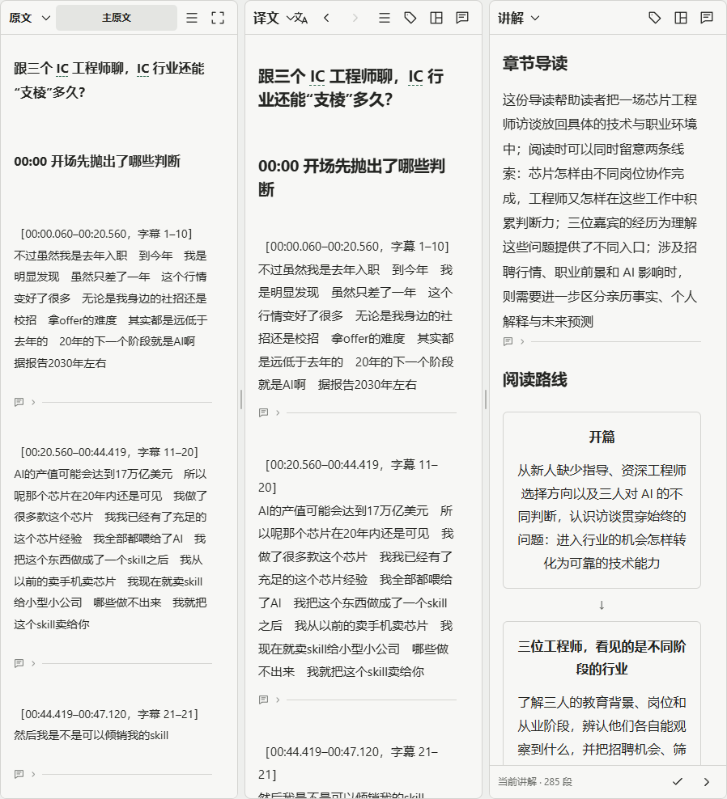
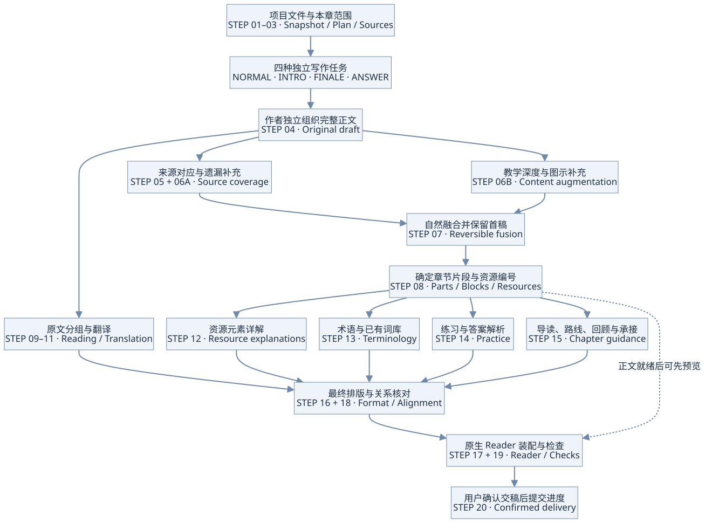
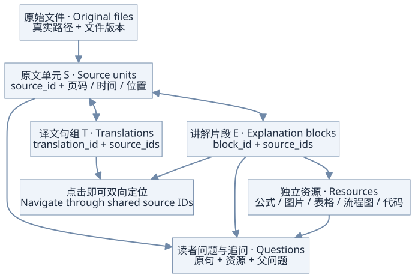
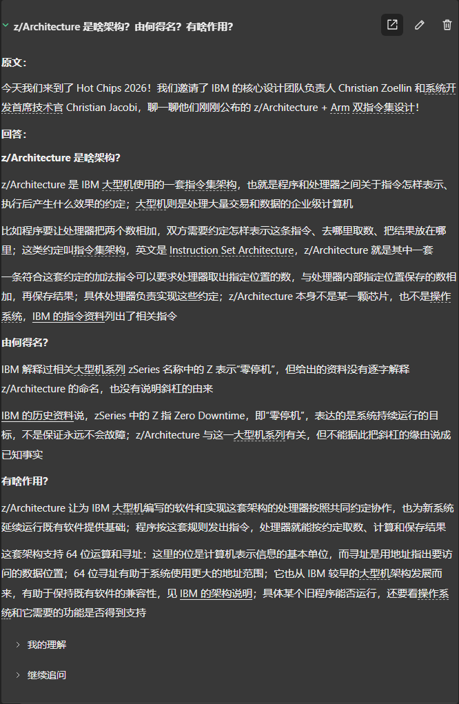
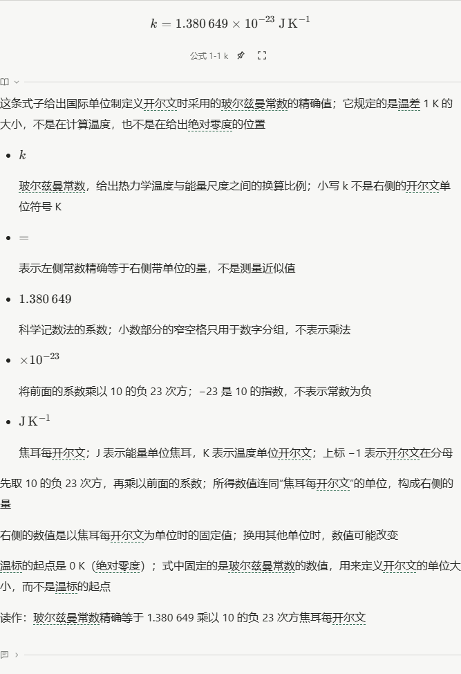
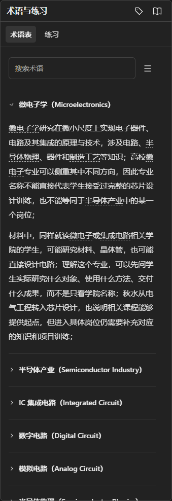
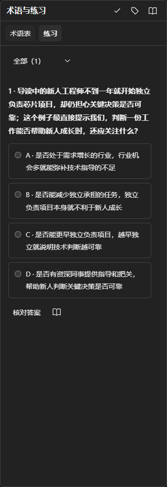
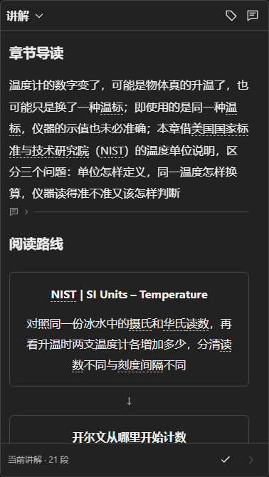
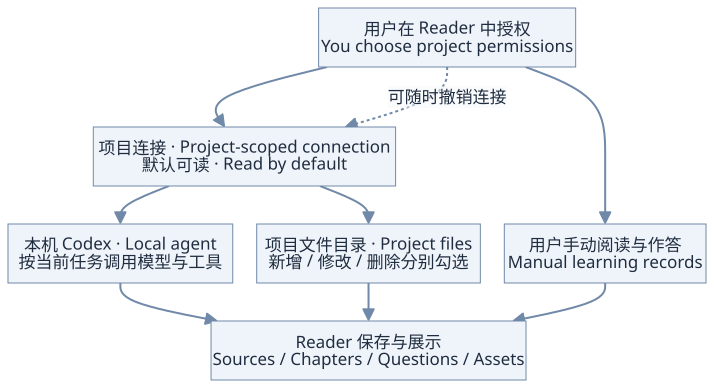

<div align="center">

<h1>ManualReader Next</h1>

<p>Turn source material into chapters you can understand, verify, and question</p>

<p>Linked sources, translations, and explanations · Expandable resource notes · Separate project files and learning records</p>

[Get started](#2-how-do-i-start-locally) · [Generation workflow](#3-how-is-a-chapter-produced) · [Deployment](docs/next-deployment.md) · [中文](README.md)

<picture>
  <source media="(prefers-color-scheme: dark)" srcset="docs/assets/readme/next/reading-dark.png">
  
</picture>

<p>Figure 1 · The deployed Reader, cropped to remove project identity, file paths, and connection information</p>

</div>

## 1 What does it help readers do

ManualReader is for sustained reading of technical articles, mathematics, course materials, and long interviews. Readers establish the context, work through complete topics, and ask follow-up questions about concepts or resources.

- **Understand the material:** explanations retain important conditions, processes, numbers, and attributed views while allowing the author to organize the article naturally
- **Check the evidence:** real source IDs connect original material, translations, and explanations; multiple files can support a chapter
- **Inspect resources:** independent equations, images, tables, Mermaid diagrams, and code can have expandable explanations and one shared follow-up entry
- **Consolidate understanding:** terms combine professional definitions with intuitive explanations; exercises support different formats, and chapter-end recaps connect the ideas
- **Continue reading:** file changes, explanation links, and manual completion are tracked separately; generating a chapter does not mark it as learned

The current engine version is **0.8.1**. Results depend on readable inputs and configured model services. Run records report actual usage and unfinished work; loading a page does not establish content quality.

## 2 How do I start locally

Use **Python 3.12**. Chapter generation also requires an installed, signed-in Codex CLI. Node.js supports code exercises and JavaScript regression checks.

```sh
git clone https://github.com/AIALRA-0/ManualReader.git
cd ManualReader
python scripts/bootstrap_reader.py
```

The bootstrapper creates a local virtual environment, installs dependencies, and opens Reader. Platform launchers are `scripts/Start-Reader.cmd` on Windows, `scripts/Start-Reader.command` on macOS, and `scripts/Start-Reader.sh` on Linux.

To manage the environment yourself and keep logs in the foreground:

```sh
python -m pip install -r requirements.txt
python scripts/serve_reader.py --port 8939
```

The server listens on loopback by default. Project and learning data go into the Git-ignored `instance/` directory. A short cache example lets you inspect the interface before generating anything; it is not a complete generated textbook.

Use “Connect Codex” in the page to create a project-scoped connection and follow its client download instructions. Put originals in the project's `source/` directory, authorize import, and use the current `teach` workflow. A new project starts with “0. 导读”; subsequent chapters follow the material. See the [connection guide](docs/agent-connection.md) for endpoints and permissions.

## 3 How is a chapter produced

Next separates scope selection, writing, and postprocessing. A task card identifies source ranges, knowledge themes, and necessary preceding context. The Writer reads the originals and produces a first draft. Scripts maintain source identities, resources, versions, and delivery records.

<div align="center">



<p>Figure 2 · Responsibilities and dependencies across 20 steps; independent work can overlap without a batch-wide stage barrier</p>

</div>

<div align="center">

<p>Table 1 · Four modes serve different reading tasks</p>

| Mode | When to use it | What the writing should accomplish |
| --- | --- | --- |
| `INTRO` | Beginning a new material | Establish the background, objects, central questions, and prerequisites in a separate chapter 0 |
| `NORMAL` | Reading in sequence | Explain a complete topic, connecting events, mechanisms, derivations, and evidence |
| `FINALE` | A user requests synthesis or closure | Synthesize actual taught chapters and suggest grounded next directions |
| `ANSWER` | An in-depth response to a real question | Use the current question, selection, and necessary parent context without unrelated question styles |

</div>

All four modes share postprocessing capabilities. Everyday questions use Reader's native Q&A flow; the engine's `ANSWER` mode supports complete answer tasks. These are distinct call paths.

Writing uses one main Writer call. Augmentation and fusion have separate responsibilities, without an additional repetitive review stage. Main writing defaults to Sol High; explicitly configured local editing and resource batches use their designated settings. Translation uses DS. Receipts report the model actually used.

The connected `teach` client starts translation after the first draft, overlapping it with mapping and augmentation. The batch executor can also start independent tasks earlier when sources are ready. See [architecture and execution boundaries](docs/architecture.md).

## 4 How do sources, translations, and explanations connect

The system maintains two main relationships: **source S ↔ translation T** and **source S ↔ explanation Block E**. Translations and explanations locate each other through shared source IDs rather than a third independent mapping.

<div align="center">



<p>Figure 3 · Source identity connects translation, prose, resources, and Q&A; reverse relationships are calculated</p>

</div>

The main original displays the chapter's central material. An authorized Agent may select it; references to other files open neighboring original tabs. Translation assembly uses scripts to retain headings, paragraphs, equations, tables, and source boundaries rather than calling a model again to tidy existing translations.

Percentages report distinct facts and use two decimal places:

- **Translation processing:** eligible sources translated or explicitly retained; failures and unprocessed sources remain in the denominator
- **Explanation association:** links between current material files and explanations; navigation-only associations are identified separately from substantive teaching
- **Project progress:** the equal-weight mean of effective file coverage contributes half, and user manual completion contributes half; previews do not create manual completion records

## 5 What does the reading experience look like

### 5.1 How can readers ask about the current content

Originals, translations, prose, and resource notes retain question context. Q&A and BP use native components so readers can follow up and return to the selected material.

<div align="center">



<p>Figure 4 · Actual Q&A captured on 2026-11-02; questions remain attached to their reading context</p>

</div>

### 5.2 How are equations and figures explained

Each independent resource keeps its number and a nearby expandable note describing actual elements, operations, or visual relationships. Simple inline symbols are not turned into separate explanation panels.

<div align="center">



<p>Figure 5 · The resource and its explanation share the same follow-up context</p>

</div>

### 5.3 How do terms and exercises support learning

Terms reuse the existing dictionary where possible, then cover relevant concepts from the task card and prose. Clicking a term locates its use. Exercises retain native grading and explanations instead of reducing every task to multiple choice.

All four chapter modes and daily answers place at least one reading question at the end of each actual Part. Existing questions and attempts are preserved. Terms retain professional and intuitive explanations with links back to answers; recovery fills missing items while reusing prose and successfully handled translations.

<div align="center">



<p>Figure 6 · Formal meaning and intuitive understanding appear together</p>



<p>Figure 7 · Different exercise types use their corresponding controls</p>

</div>

### 5.4 What changes on a narrow screen

Desktop layouts and pane widths are adjustable. Narrow screens switch the visible panel while preserving the same project and locations.

<div align="center">



<p>Figure 8 · The same website in a narrow reading view</p>

</div>

## 6 What may an Agent access

A connection is scoped to its project and permits reading by default. Creating, modifying, and deleting files require separate user selections. The server rereads permissions on each request, and revocation invalidates the token. Project authorization does not grant arbitrary filesystem access.

<div align="center">



<p>Figure 9 · Reader checks file permissions and maintains manual learning records separately</p>


<p>Figure 10 · Only public permission controls are included in this crop</p>

</div>

Readers can inspect generated Markdown in the project file tree:

```text
project/
├── source/                       originals
└── explanations/
    ├── 0. 导读.md                fused reading draft
    ├── 0. 导读.raw.md            unmodified model first draft
    ├── 0.1 Chapter title.md      subsequent chapters use actual titles
    └── media/                    actual media files
```

Reader checks file versions again before formal delivery. Preview, formal delivery, and manual completion are separate actions; saving does not invent learning records.

## 7 Where do code and scripts live

```text
ManualReader/
├── reader/            Reader service, native UI, project APIs, browser dependencies
├── next/              Next engine, frozen prompts, 20 steps, execution tools
├── scripts/           Local launchers, asset builds, documentation diagrams
├── docs/              Current connection, architecture, deployment, screenshots
├── Demo/              Examples, regression tests, archived documentation
├── requirements.txt   Reader runtime dependencies
└── pytest.ini         Unified test entry
```

The root contains project entry documentation and dependency configuration. See the [script catalog](scripts/README.md), [engine guide](next/README.md), and [historical archive](Demo/legacy-docs/README.md). Runtime databases, connection credentials, and generated private material do not belong in Git.

## 8 How do I validate a change

In an environment with runtime dependencies installed:

```sh
python -m pip install pytest
python -m pytest Demo next/tests -q
```

JavaScript regressions use Node.js:

```powershell
# PowerShell
Get-ChildItem Demo/test_*.js | ForEach-Object { node $_.FullName; if ($LASTEXITCODE) { throw $_.Name } }
```

```sh
# Bash
for test in Demo/test_*.js; do node "$test" || exit; done
```

These checks cover contracts, source and resource locations, permissions, assembly, and browser behavior. Real model generation needs service credentials and incurs costs. Automated success does not replace human reading of generated content.

## 9 Where do deployment and feedback begin

Public deployments should use an HTTPS login proxy and keep source releases, static assets, and private data separate. Upgrade into a new release directory while retaining the database and a rollback version. Commands are in the [deployment guide](docs/next-deployment.md).

Report reproducible issues through [Issues](https://github.com/AIALRA-0/ManualReader/issues), including expected and actual behavior. Redacted screenshots can help; never attach tokens, connection codes, private material, or a complete runtime database.

No separate license has been assigned to this project's source. See [THIRD_PARTY_NOTICES.md](THIRD_PARTY_NOTICES.md) for component and voice-model terms. Website screenshots show an actual deployed Reader; [asset provenance](docs/assets/readme/next/README.md) explains their capture and the diagram sources.
