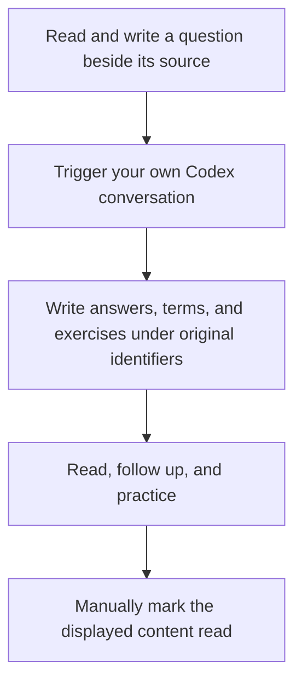

<div align="center">

<h1>ManualReader</h1>

<p>Read sources, translations, and explanations together, with your questions and understanding kept beside them</p>

[Get started](#2-how-to-start-reading) · [Six-panel walkthrough](#3-how-the-six-areas-work-together) · [Feature gallery](docs/features.md) · [Download](https://github.com/AIALRA-0/ManualReader/releases/latest) · [简体中文](README.md)

</div>

<div align="center">


Figure 1 A user-provided actual hardware reading session, cropped to remove browser chrome and the site address. The section screenshots below were captured through a read-only production connection

</div>

[Download current source](https://github.com/AIALRA-0/ManualReader/archive/refs/heads/main.zip) for the project-file features below

## 1 How this workspace helps you read

Read the material, write questions beside the sentence that stopped you, and manually ask your own Codex conversation to answer them. The reader saves sources, answers, terms, exercises, and notes without requiring a generated course before you begin

- Keep a learning outline separate from source-file outlines, with manual reading and exercise progress
- Switch, split, or stack source, translation, and explanation panels
- Click to locate corresponding content while retaining each question's original passage and follow-up relationships
- Autosave questions and notes; new or updated answers turn yellow; each question stays yellow until its current answer is read, turns cyan while its own exercise is unfinished, and turns green when complete; follow-ups do not change their ancestors
- Choose term-name modes per panel, check exercise explanations, and revisit previous mistakes
- Switch mobile tabs and enlarge images, tables, formulas, and diagrams

## 2 How to start reading

Requirements: Python 3.10 or later, a modern browser, and network access for first-time dependency installation. Run the launcher in the extracted repository directory

```powershell
# Windows: create a local environment and launch the reader
.\Start-Reader.ps1
```

```sh
# Linux or macOS: create a local environment and launch the reader
sh ./Start-Reader.sh
```

Open the local address printed by the launcher. To load the complete scene shown above, run this command in the same directory and open the new Demo link printed in the terminal

```sh
# Create an isolated synthetic project without overwriting existing material
python Demo/load_walkthrough.py --base http://127.0.0.1:8939
```

Use the launcher's actual port if it differs. The walkthrough includes four chapters, source text, translations, explanations, twelve questions and follow-ups, terms, and exercises. Its fixed content is included in the repository; loading it calls no model and changes no other project's notes or progress

See [deployment](docs/deployment.md) for installation and backups, and [importing](docs/importing.md) for PDFs, websites, presentations, repositories, and empty projects

## 3 How the six areas work together

### 3.1 Use the outline to keep your place

The learning outline remains available when you open another source file. Reading progress changes when you manually mark the displayed content as read

<div align="center">


Figure 2 The existing learning route and manual progress; optional double rings combine reading and exercise percentages

</div>

### 3.2 Compare sources, translations, and explanations

These three areas show the original material, its translation, and additional teaching. Clicking locates and highlights matching content; ordinary scrolling remains a reading action

<div align="center">


Figure 3 Source, faithful translation, and additional explanation keep distinct places in an actual reading session

</div>

### 3.3 Keep questions and follow-ups anchored

Write initial questions below a translated or explained passage; they autosave. Answers appear in the question panel with source and answer separated. Follow-ups stay nested beneath their parent, while notes and follow-up inputs are initially collapsed

<div align="center">


Figure 4 Question triangles distinguish unread or unanswered content, unfinished exercises, and completed answers independently for every question

</div>

### 3.4 Revisit terms and exercise your understanding

Terms contain an independent definition and a concrete explanation. Seven naming modes are configured per panel, with optional hover names and first-occurrence replacement. Exercises explain the selected judgment and keep previous mistakes available for review

<div align="center">


Figure 5.1 Terms collected during actual reading retain definitions and concrete explanations


Figure 5.2 Exercises from the current chapter; optional automatic checking evaluates a choice immediately

</div>

See the [sectioned gallery](docs/features.md) for term modes, deletion confirmation, autosave, and loading states

Sol high writes the lesson or answers, reusable terms and placed exercises in one ordinary-service pass. Sol low handles name-only repairs and clean coordination. The client reuses relevant excerpts from pages actually opened in the same project, preserves correct content during a single field patch, and records model usage receipts including coordination. See [the generation flow and public prompt source](docs/generation-flow.md) and [generation validation](docs/generation-validation.md). Existing material, notes, practice attempts and manual reading progress remain intact.

### 3.5 How can I save color combinations

Settings include eight light/dark palettes. Save multiple favorites, choose one default, or edit seven highlight and progress colors and save a custom palette. Existing colors stay in place until you choose a combination

<div align="center">


Figure 5.3 The real settings page supports multiple favorites and one default palette

</div>

### 3.6 How to browse project files without leaving your lesson

Each project has an independent file root. Settings can change the default parent directory for new projects while existing projects stay in place. The shared outline can show reading progress, exercise progress, double rings, or files, in one, two, or three vertically resizable panes. Hidden files are included and OS file events keep expanded folders up to date without directory polling. Header menus select each outline mode; context menus, drag uploads, text editing, and a recoverable trash support file management

Files open in closable, draggable tabs inside the existing source pane. The pinned source tab follows reading mappings: clicking a mapping in an explanation or question returns to it and retains the other tabs. Browsing files does not change the lesson or manual reading progress. Compact panes move source tools into a menu; the viewer can expand on its own

<div align="center">

<picture>
  <source media="(prefers-color-scheme: dark)" srcset="docs/assets/readme/project-files-dark.png">
  
</picture>

Figure 5.4 The file tree and learning route stay available while an ordinary tab previews a three-page PDF; captured from a synthetic project in the actual application with the physical path redacted

</div>

Code, Markdown, images, tables, media, and documents have format-specific previews. Local LibreOffice provides Office layout previews; other binary files retain metadata, byte previews, and downloads. See [format support, project permissions, and Agent file APIs](docs/project-files.md)

Local file links in explanations open source-panel tabs. Matching question templates appear as faint inline text: use Up/Down to switch, Tab to accept, or tap the completion hint on mobile. Questions at every nesting level share one accordion group, so only one answer is open at a time

```sh
# Create a fresh local file-viewing Demo without calling a model
python Demo/load_project_files.py --base http://127.0.0.1:8939
```

This feature is available on the current main branch. The command creates a new Demo and leaves existing projects and learning records untouched

## 4 How to read on a phone

Bottom tabs switch source, translation, explanation, questions, and study content. The selected panel uses the available width and retains the same project records

<div align="center">


Figure 6 A running mobile-width view, tested with browser viewport emulation

</div>

Optional self-hosted speech input shows recording state and lets you edit the transcription. See [offline voice](docs/offline-voice.md) for installation and recognition limits

## 5 How an Agent connects to your reading

Copy the current project's connection instructions into your own Codex conversation. The Agent reads saved questions and writes results through project APIs; you still trigger the conversation manually

<div align="center">



Figure 7 The page displays and records the work; the reader controls learning progress

</div>

Connections are project-scoped. Agents cannot mark manual progress or change personal notes and exercise attempts. Deletion requires a preview followed by a scoped confirmation. See the [Agent API](docs/agent-api.md) for current fields, clients, and writing rules

## 6 How performance and stability are checked

The running code reuses calculated learning data, avoids repeated translation reconstruction when restoring a reading position, and derives chapter counts from accumulated totals instead of rescanning every paragraph for every chapter. The distribution omits obsolete UI copies and assembly scripts no longer used by its launchers

Deterministic checks and browser tests cover answer editing, chapter-bound writeback, restart recovery, manual completion, double-ring progress, automatic checking, and desktop/mobile layouts. Large-project measurements use a 2,271-passage exam project and an interview with dozens of saved questions. See [validation](docs/validation.md) and [performance](docs/performance.md) for actual results, conditions, and reproduction

This version passes 114 deterministic tests. The earlier paired public HTTPS benchmark used 48 chapter changes per project per version: EXAM2 median 756 → 626 ms and P95 2037 → 1386 ms; interview median 511 → 422 ms and P95 670 → 540 ms. See [performance methodology](docs/performance.md) for maxima and conditions

Answers and explanations share the public [writing rules](reader_prompts.py). Writers actively search authoritative sources for missing historical, naming or specification facts, then answer the actual question. See [cross-domain writing tests](docs/writing-quality.md) for timing, usage and scope

## 7 How data and licenses are handled

The public repository contains application code, dependencies, synthetic material, and screenshots, without private reading data, databases, credentials, recordings, or model weights. Back up data before upgrades and retain existing reading directories

Local launch binds to loopback. Public deployment requires HTTPS, authentication, and project authorization. Project source has no separately assigned license; dependency notices are in [third-party notices](THIRD_PARTY_NOTICES.md)
