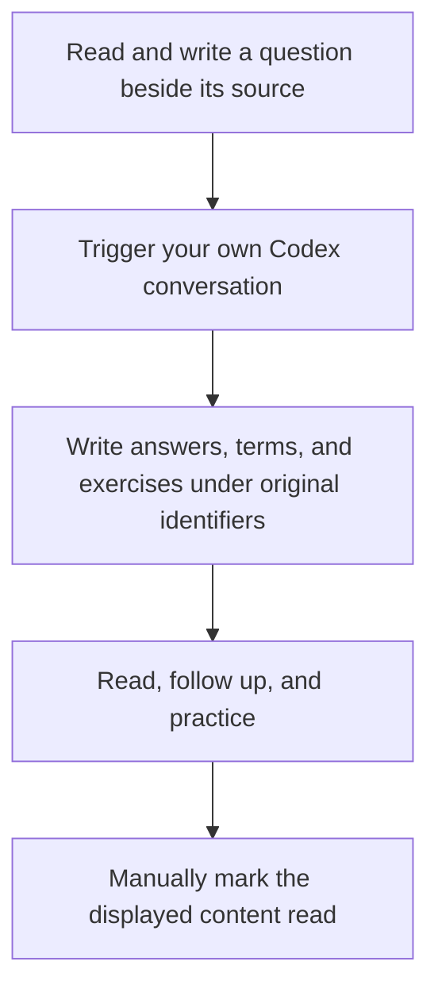

<div align="center">

<h1>ManualReader</h1>

<p>Read sources, translations, and explanations together, with your questions and understanding kept beside them</p>

[Get started](#2-how-to-start-reading) · [Six-panel walkthrough](#3-how-the-six-areas-work-together) · [Feature gallery](docs/features.md) · [Download](https://github.com/AIALRA-0/ManualReader/releases/latest) · [简体中文](README.md)

</div>

<div align="center">

<picture>
  <source media="(prefers-color-scheme: dark)" srcset="docs/assets/readme/workspace-dark.png">
  
</picture>

Figure 1 A complete running workspace with a self-authored synthetic price-service article and fixed answers; matching passages are highlighted across source, translation, and explanation

</div>

## 1 How this workspace helps you read

Read the material, write questions beside the sentence that stopped you, and manually ask your own Codex conversation to answer them. The reader saves sources, answers, terms, exercises, and notes without requiring a generated course before you begin

- Keep a learning outline separate from source-file outlines, with manual reading and exercise progress
- Switch, split, or stack source, translation, and explanation panels
- Click to locate corresponding content while retaining each question's original passage and follow-up relationships
- Autosave questions and notes; updated answers turn yellow, and opening them saves the green state
- Choose term-name modes per panel, check exercise explanations, and revisit previous mistakes
- Switch mobile tabs and enlarge images, tables, formulas, and diagrams

## 2 How to start reading

Requirements: Python 3.10 or later, a modern browser, and network access for first-time dependency installation. Run the launcher in the extracted repository directory

```powershell
# Windows: create a local environment and launch the reader
.\Start-Reader.ps1
```

```sh
# Linux or macOS: create a local environment and launch the reader
sh ./Start-Reader.sh
```

Open the local address printed by the launcher. To load the complete scene shown above, run this command in the same directory and open the new Demo link printed in the terminal

```sh
# Create an isolated synthetic project without overwriting existing material
python Demo/load_walkthrough.py --base http://127.0.0.1:8939
```

Use the launcher's actual port if it differs. The walkthrough includes four chapters, source text, translations, explanations, twelve questions and follow-ups, terms, and exercises. Its fixed content is included in the repository; loading it calls no model and changes no other project's notes or progress

See [deployment](docs/deployment.md) for installation and backups, and [importing](docs/importing.md) for PDFs, websites, presentations, repositories, and empty projects

## 3 How the six areas work together

### 3.1 Use the outline to keep your place

The learning outline remains available when you open another source file. Reading progress changes when you manually mark the displayed content as read

<div align="center">


Figure 2 The outline keeps reading order, the current chapter, and progress together; no chapter has been marked read in this demonstration

</div>

### 3.2 Compare sources, translations, and explanations

These three areas show the original material, its translation, and additional teaching. Clicking locates and highlights matching content; ordinary scrolling remains a reading action

<div align="center">


Figure 3 The explanation traces which action a cache hit saves while retaining its source relationship

</div>

### 3.3 Keep questions and follow-ups anchored

Write initial questions below a translated or explained passage; they autosave. Answers appear in the question panel with source and answer separated. Follow-ups stay nested beneath their parent, while notes and follow-up inputs are initially collapsed

<div align="center">


Figure 4 Opened answers use green triangles; unopened follow-ups remain yellow

</div>

### 3.4 Revisit terms and exercise your understanding

Terms contain an independent definition and a concrete explanation. Seven naming modes are configured per panel, with optional hover names and first-occurrence replacement. Exercises explain the selected judgment and keep previous mistakes available for review

<div align="center">


Figure 5.1 The term definition and concrete explanation share the same price-service example


Figure 5.2 An exercise checks a judgment from the same material and explains the selected answer

</div>

See the [sectioned gallery](docs/features.md) for term modes, deletion confirmation, autosave, and loading states

## 4 How to read on a phone

Bottom tabs switch source, translation, explanation, questions, and study content. The selected panel uses the available width and retains the same project records

<div align="center">


Figure 6 A running mobile-width view, tested with browser viewport emulation

</div>

Optional self-hosted speech input shows recording state and lets you edit the transcription. See [offline voice](docs/offline-voice.md) for installation and recognition limits

## 5 How an Agent connects to your reading

Copy the current project's connection instructions into your own Codex conversation. The Agent reads saved questions and writes results through project APIs; you still trigger the conversation manually

<div align="center">



Figure 7 The page displays and records the work; the reader controls learning progress

</div>

Connections are project-scoped. Agents cannot mark manual progress or change personal notes and exercise attempts. Deletion requires a preview followed by a scoped confirmation. See the [Agent API](docs/agent-api.md) for current fields, clients, and writing rules

## 6 How performance and stability are checked

The running code reuses calculated learning data, avoids repeated translation reconstruction when restoring a reading position, and derives chapter counts from accumulated totals instead of rescanning every paragraph for every chapter. The distribution omits obsolete UI copies and assembly scripts no longer used by its launchers

Checks cover thirty-six synthetic unit tests, answer deletion and editing under the original identifier, loading-error recovery, and desktop/mobile layouts. See [validation](docs/validation.md) and [performance](docs/performance.md) for actual results, conditions, and reproduction

## 7 How data and licenses are handled

The public repository contains application code, dependencies, synthetic material, and screenshots, without private reading data, databases, credentials, recordings, or model weights. Back up data before upgrades and retain existing reading directories

Local launch binds to loopback. Public deployment requires HTTPS, authentication, and project authorization. Project source has no separately assigned license; dependency notices are in [third-party notices](THIRD_PARTY_NOTICES.md)
