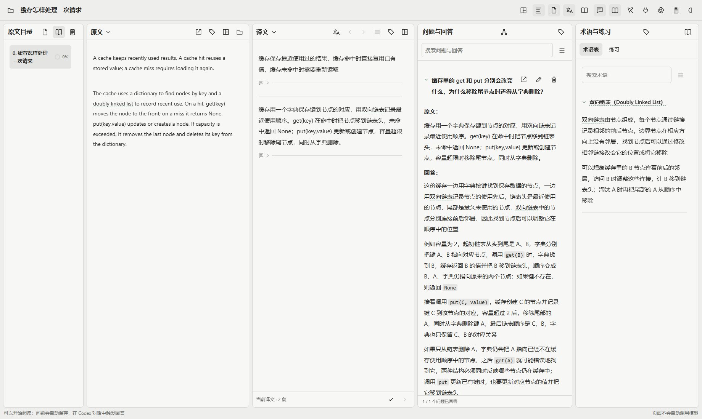
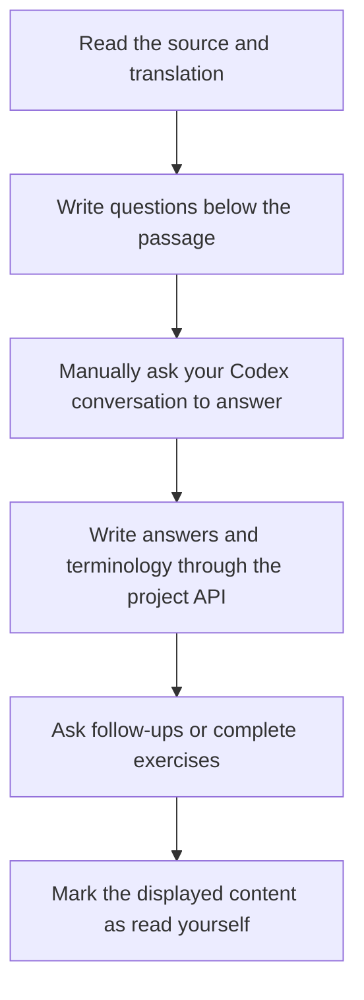
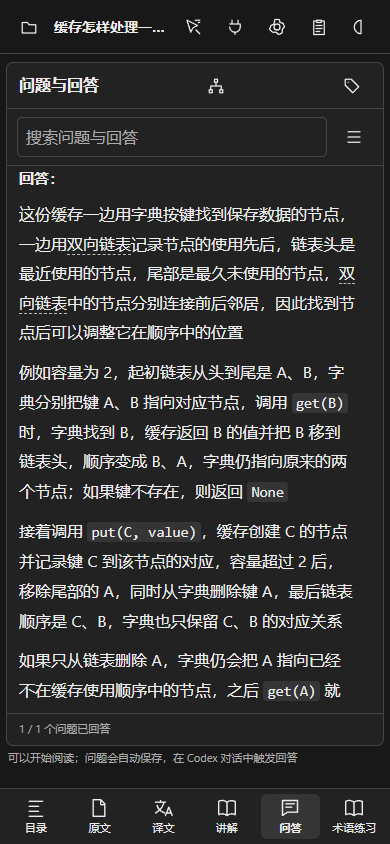

<div align="center">

<h1>ManualReader</h1>

<p>Read the source, compare its translation, and keep your questions beside the passage</p>

[Get started](#2-get-started) · [Reading flow](#3-complete-a-reading-session) · [Agent API](docs/agent-api.md) · [简体中文](README.md)

</div>

<div align="center">

<picture>
  <source media="(prefers-color-scheme: dark)" srcset="docs/assets/readme/desktop-dark.png">
  
</picture>

Figure 1 The running synthetic cache example, with a Terra high answer that traces how a dictionary and linked list change together

</div>

## 1 What this application does

ManualReader is a reading workspace for people who compare source material, ask follow-up questions, and keep a record of their understanding

Read the source and translation, write questions below a passage, and manually ask your own Codex conversation to answer them. The application displays and records the results; it does not automatically generate a course before you can start reading

- Switch between source, translation, and explanation, or arrange them in columns and vertical splits
- Keep questions anchored to passages, with nested follow-ups, personal notes, and exercise results
- Configure seven term-name modes independently in five panels; hover shows the full name by default without rewriting the source
- Read original PDF pages and locations, with Markdown support for mathematics, tables, code, images, and Mermaid diagrams
- Resize desktop columns or switch mobile tabs
- Optionally run offline speech recognition with a visible recording timer and stop control
- Autosave understanding notes and review mistakes in rounds; a correct review removes an item without changing the original attempt
- Enlarge images, tables, formulas, and diagrams; writers can reuse source images, draw flowcharts, or generate an actual illustration when useful

An Agent can also write chapter explanations for code projects or projects without an original document

## 2 Get started

Requirements: Python 3.10 or later and a modern browser. Initial dependency installation needs network access

- First, download the repository and open a terminal in its directory
- Next, run the launcher for your operating system; it creates a local Python environment without changing system packages

```powershell
# Windows: create a local environment and start the reader
.\Start-Reader.ps1
```

```sh
# Linux or macOS: create a local environment and start the reader
sh ./Start-Reader.sh
```

- Open the address printed by the launcher, normally `http://localhost:8939`; the repository starts with a synthetic cache example
- Import your own material, or ask a question about the demonstration

To load the actual model answer shown in the screenshots, run `python Demo/load_example.py --base http://127.0.0.1:8939`. Use the port printed by your launcher if it differs; this command only writes to the synthetic demonstration project

See [deployment instructions](docs/deployment.md) for manual installation, custom ports, and data migration

See [import behavior and limitations](docs/importing.md) for file formats, source locations, and translation responsibilities

## 3 Complete a reading session

<div align="center">



Figure 2 The reader controls progress; the Agent does not mark material as read

</div>

Use the connection button and paste its instructions into your Codex conversation. Each answer displays its source separately. Personal notes and follow-up inputs start collapsed. Answers, terms, and exercises accumulate without clearing earlier notes

<div align="center">



Figure 3 Mobile tabs keep the selected panel at full width

</div>

## 4 Connect an Agent

Connections are scoped to one project. The API uses stable file, passage, sentence, and question identifiers

- Read the question pool and corresponding source material
- Write translations against their original identifiers
- Save chapter explanations with source associations
- Append answers, reusable terms, and multiple-choice exercises
- Advance the learning chapter only after the reader manually marks it complete

See the [Agent API](docs/agent-api.md) and [deployment instructions](docs/deployment.md) for contracts, pairing, and authentication

## 5 Speech and visual explanations

The speech pilot uses a quantized SenseVoice ONNX model through sherpa-onnx, running on your own machine. It requires an initial model download and FFmpeg; recordings are processed in memory rather than saved as reading material

Click the microphone beside an input, speak, and click again to finish. The transcript remains editable. See [offline speech](docs/offline-voice.md) for installation and limitations

Answers prefer real source images. Mermaid is available for process explanations. New illustrations are requested only when existing images or diagrams are insufficient, and depend on the connected Codex tools

## 6 Validation and current limits

Checks cover answer formatting, collapsed inputs, four term display modes, ambiguous aliases, protected mathematics and code, image references, and desktop/mobile layout

Small writing comparisons used mathematics, processor architecture, caching, osmosis, request retries, probability, and temperature control with Terra high on standard service. See [validation](docs/validation.md) for conditions and scope

Speech remains a pilot. Technical English names can be misrecognized; source anchoring lets the reader say “why does this function work this way” and edit names afterward

## 7 Data, support, and licensing

The public repository contains application code, required frontend dependencies, synthetic demonstrations, and validation notes. It excludes real documents, question databases, pairing credentials, recordings, and model weights

Back up the complete runtime data directory before migration or upgrades. Local service binds to loopback; public deployment requires HTTPS, login protection, and project-specific pairing

Report reproducible issues with synthetic examples. Do not publish private documents, connection codes, or reading records

No project source license has been selected yet. Third-party components retain their respective licenses; see [third-party notices](THIRD_PARTY_NOTICES.md)
