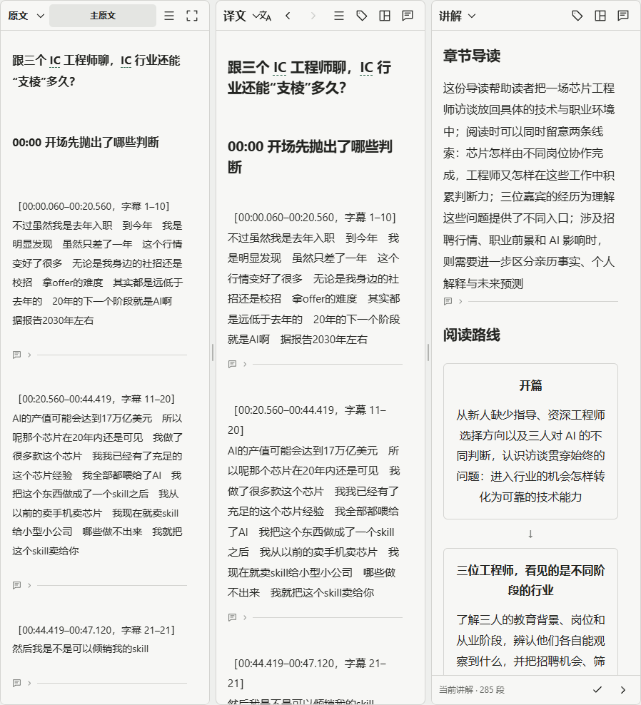
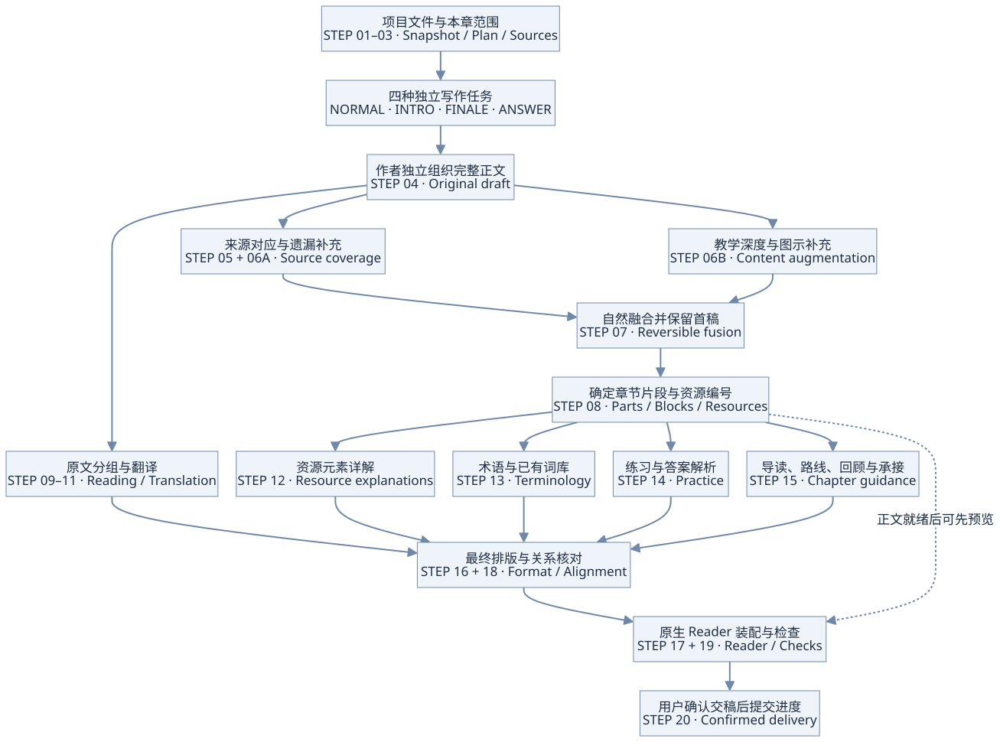
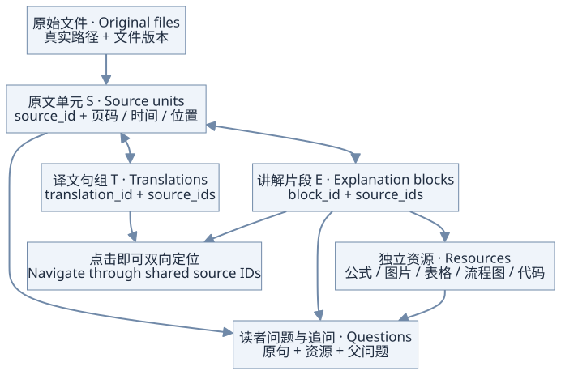
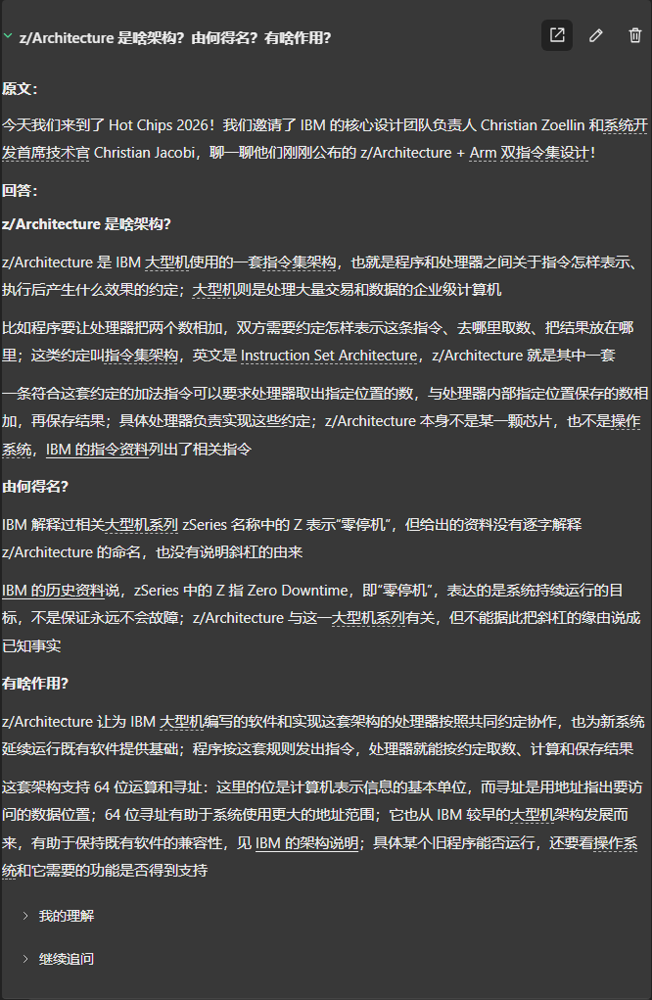
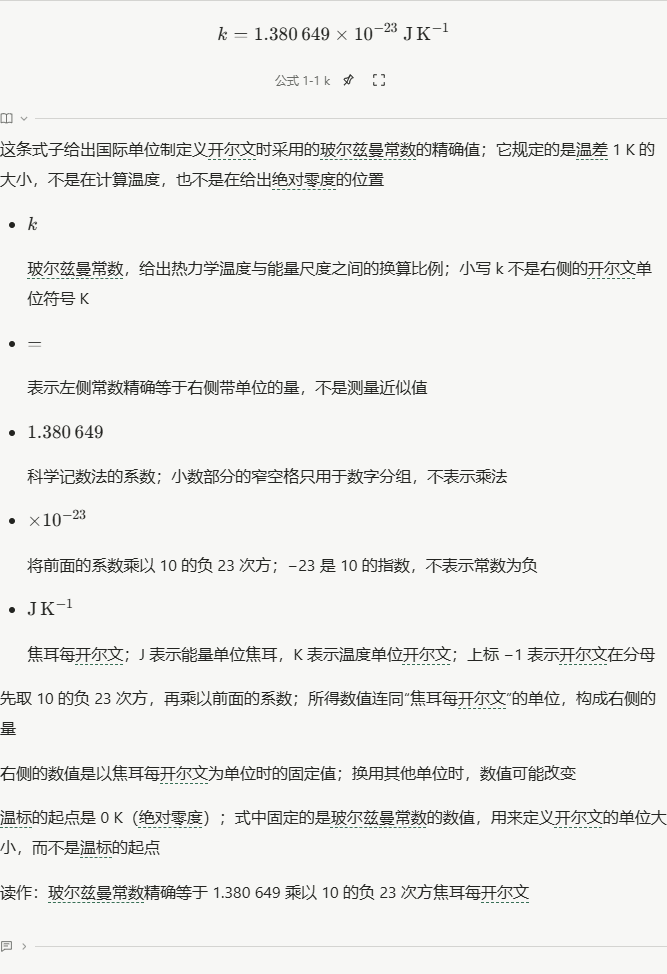
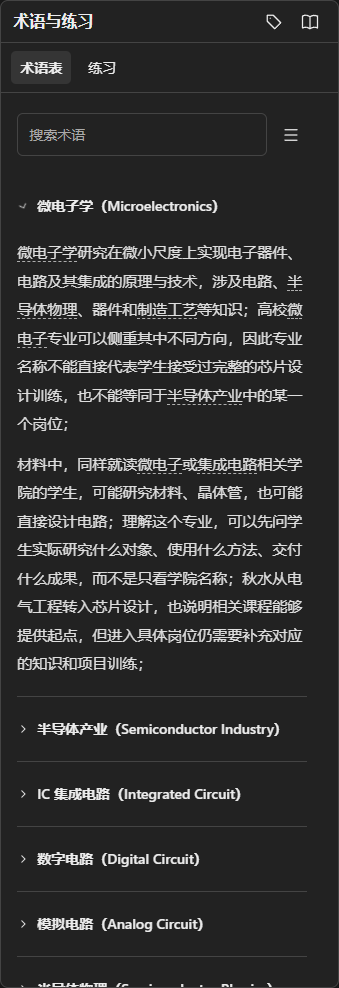
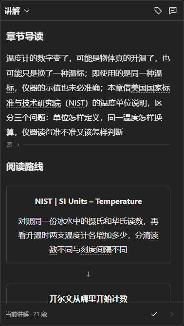
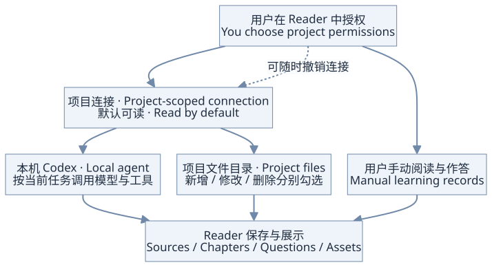

<div align="center">

<h1>ManualReader Next</h1>

<p>把材料读成能理解、能核对、能继续追问的章节</p>

<p>原文、译文与讲解联动 · 资源逐项解读 · 项目文件与学习记录分开保存</p>

[开始使用](#2-怎样在本机开始阅读) · [生成流程](#3-一章内容怎样生成) · [开发与部署](docs/next-deployment.md) · [English](README.en.md)

<picture>
  <source media="(prefers-color-scheme: dark)" srcset="docs/assets/readme/next/reading-dark.png">
  
</picture>

<p>图 1 · 实际网站的阅读区；截图裁去了项目身份、文件路径和连接信息</p>

</div>

## 1 它帮助读者做什么

ManualReader 面向需要认真读完一份材料的人

技术文章、数学论文、课程资料或长访谈都可以成为项目材料，读者先建立整体认识，再按章节深入，遇到公式、图片和概念时继续追问

- **看懂材料** — 讲解从真实原件取材，保留关键条件、过程、数字和观点归属；正文允许自然组织，不按知识点列表逐条填空
- **核对依据** — 原文、译文和讲解通过真实来源编号关联；点击关联内容可回到对应原件，多个文件可以共同支撑一章
- **解释资源** — 独立公式、图片、表格、Mermaid（用文本描述流程与关系的制图工具）和代码可以有自己的折叠解读；资源本体与解读共用一个追问入口
- **积累理解** — 术语提供专业定义和直观解释，练习支持不同题型，章末回顾帮助读者把内容串起来
- **继续阅读** — 文件变化、讲解关联与手动完成分别记录；Agent 不会把生成一章等同于读者已经学完

当前引擎版本为 **0.8.1**

真实效果取决于材料是否可读及所连接的模型服务；运行记录保留实际用量和未完成项，不能用页面能打开代替内容验收

## 2 怎样在本机开始阅读

从本仓库下载完整源码

使用 **Python 3.12**；生成章节还需要安装并登录 Codex CLI

Node.js 用于代码练习及 JavaScript 回归测试

```sh
git clone https://github.com/AIALRA-0/ManualReader.git
cd ManualReader
python scripts/bootstrap_reader.py
```

启动器会创建本地虚拟环境、安装依赖并打开 Reader

Windows 也可以运行 `scripts/Start-Reader.cmd`，macOS 使用 `scripts/Start-Reader.command`，Linux 使用 `scripts/Start-Reader.sh`

希望自己管理环境或查看前台日志时，可以直接运行：

```sh
python -m pip install -r requirements.txt
python scripts/serve_reader.py --port 8939
```

服务默认只监听本机，项目和学习数据放在被 Git 忽略的 `instance/`

首次启动附带一个简短缓存示例，便于先检查阅读界面；它不代表已经生成了一份完整教材

在页面的「连接 Codex」中创建当前项目的连接，按网页给出的命令下载客户端

将材料放入项目的 `source/`，授权 Agent 登记原件，再运行当前 `teach` 流程

新项目先生成「0. 导读」，后续章节按材料顺序推进

连接步骤、接口及权限见 [Agent 连接说明](docs/agent-connection.md)

## 3 一章内容怎样生成

Next 分别处理取材、写作与后处理

规划卡确定材料范围、知识主题与必要前文；Writer 直接阅读材料并完成首稿；脚本维护来源、资源、版本和保存记录

<div align="center">



<p>图 2 · 20 STEP 的职责与依赖；不依赖彼此的任务可以同时运行，当前文章就绪后即可向下推进</p>

</div>

<div align="center">

<p>表 1 · 四种模式解决不同的阅读任务</p>

| 模式 | 什么时候使用 | 正文应当完成什么 |
| --- | --- | --- |
| `INTRO` | 首次进入一份材料 | 建立背景、关键对象、整体问题和阅读前置，单独保存为第 0 章 |
| `NORMAL` | 按顺序深入材料 | 充分讲清一个完整主题，保持事件、机制、推导与证据之间的联系 |
| `FINALE` | 用户需要阶段性收束或总结 | 根据真实已讲章节综合认识，并提出有依据的后续方向 |
| `ANSWER` | 围绕真实问题作深入回答 | 使用当前问题、选中内容及必要父问题上下文，避免无关历史问法 |

</div>

四种模式共用后处理能力

网页中的日常提问仍复用原生问答流程；需要完整回答任务时，引擎提供 `ANSWER`，两者不会被包装成同一种调用

正文保持一次主要 Writer 调用，补充和融合另有明确职责，不增加独立的反复审稿关卡

默认主要写作使用 Sol High；明确指定的局部编辑和资源批处理使用各自配置，翻译走 DS 服务

运行回执记录实际模型，不能只凭默认配置认定某次调用

连接客户端的 `teach` 在首稿返回后启动翻译，并与来源映射、补充处理重叠执行；批量执行器也支持在来源就绪后提前启动独立任务

详见 [架构与执行边界](docs/architecture.md)

## 4 原文、译文和讲解怎样对上

系统保留两组主要关系，**原文 S ↔ 译文 T**、**原文 S ↔ 讲解 Block E**

译文与讲解通过共同的来源编号相互定位，不再生成第三套容易漂移的映射

<div align="center">



<p>图 3 · 来源身份贯穿翻译、正文、资源与问答；反向关系由程序计算</p>

</div>

主原文用于展示当前章的核心材料，Agent 可以在授权项目内选择它；关联到其他文件的内容会打开旁边的原件标签页

译文排版优先使用脚本保留标题、段落、公式、表格与来源边界，不靠重新调用模型整理已经译好的文字

以下覆盖率分别表示不同事实，统一显示两位小数：

- **译文处理** — 应处理的来源中，已经译出或明确保留原文的比例；失败和未处理仍计入分母
- **讲解关联** — 材料目录当前有效文件与讲解的关联情况；导航归属会标明用途，不冒充实质讲解
- **项目进度** — 有效文件覆盖率等权平均，再与用户手动完成率各占一半计算；生成预览不会自动增加手动完成记录

## 5 读者实际能看到什么

### 5.1 怎样围绕当前内容继续问

原文、译文、讲解及资源解读都保留提问上下文

问答和 BP 使用原生组件，读者可以从当前段落追问，再回到所选内容核对

<div align="center">



<p>图 4 · 实际问答界面；此图采集于 2026-11-02，问题留在对应的阅读上下文中</p>

</div>

### 5.2 公式与图表怎样解释

资源本体保留原有编号，折叠解读紧贴对应资源，说明真实元素、运算或视觉关系

行内简单符号不会被拆成一排独立详解

<div align="center">



<p>图 5 · 独立资源与自己的解读放在一起，继续追问时共用同一份资源上下文</p>

</div>

### 5.3 术语与练习怎样帮助消化

术语优先复用已有词库，再覆盖任务卡中的概念与正文新术语；点击术语可以定位到使用它的内容

练习沿用原生判分与解析，不把所有任务压成单一选择题

<div align="center">



<p>图 6 · 术语把正式含义与直观理解放在一起</p>


<p>图 7 · 练习保留作答与答案核对；不同题型使用对应控件</p>

</div>

### 5.4 窄屏怎样继续阅读

桌面阅读区可以调整布局和栏宽；窄屏切换当前面板，内容与定位仍属于同一项目

<div align="center">



<p>图 8 · 同一网站的窄屏阅读视图</p>

</div>

## 6 Agent 能操作哪些文件

连接只授权当前项目，默认可读

新增、修改和删除文件分别由用户勾选，服务端在每次请求时重新读取权限；撤销连接会使令牌失效

Agent 不能借项目连接访问任意系统目录

<div align="center">



<p>图 9 · 文件权限由 Reader 检查，用户手动学习记录单独维护</p>


<p>图 10 · 实际权限选项；截图只保留公开的操作控件</p>

</div>

用户可在文件目录查看生成的 Markdown：

```text
项目目录/
├── source/                       原始材料
└── explanations/
    ├── 0. 导读.md                融合后的阅读稿
    ├── 0. 导读.raw.md            模型原样首稿
    ├── 0.1 具体章节标题.md       后续讲解按实际标题命名
    └── media/                    实际媒体文件
```

Reader 在正式提交前重新核对文件版本

预览、正式交稿和用户手动完成是三个独立动作，保存接口不会用假记录填满进度

## 7 源码与脚本放在哪里

```text
ManualReader/
├── reader/            Reader 服务、原生界面、项目接口和浏览器依赖
├── next/              Next 引擎、冻结提示词、20 STEP 和执行工具
├── scripts/           本地启动、静态资源构建和文档制图
├── docs/              当前连接、架构、部署说明及实际截图
├── Demo/              示例、回归测试和历史文档
├── requirements.txt   Reader 运行依赖
└── pytest.ini         统一测试入口
```

根目录只保留项目入口说明与依赖配置

脚本用途见 [scripts/README.md](scripts/README.md)，引擎开发见 [next/README.md](next/README.md)，历史资料在 [Demo 归档](Demo/legacy-docs/README.md)

运行数据库、连接凭据及生成材料不应提交到仓库

## 8 怎样验证一次修改

在安装运行依赖的环境中执行：

```sh
python -m pip install pytest
python -m pytest Demo next/tests -q
```

JavaScript 回归使用 Node.js：

```powershell
# PowerShell
Get-ChildItem Demo/test_*.js | ForEach-Object { node $_.FullName; if ($LASTEXITCODE) { throw $_.Name } }
```

```sh
# Bash
for test in Demo/test_*.js; do node "$test" || exit; done
```

这些测试验证代码合同、来源与资源定位、权限、装配及前端行为

真实模型生成另需服务凭据并产生费用；自动测试通过不等于文章质量已经通过人工阅读

## 9 部署和反馈从哪里开始

对外部署应使用现有 HTTPS 登录代理，把源码、静态资源与私有数据分开

升级时创建新发布目录，保留原数据库和回退版本；详细命令见 [部署说明](docs/next-deployment.md)

发现问题时，请提供触发步骤、预期与实际结果

[在 Issues 提交反馈](https://github.com/AIALRA-0/ManualReader/issues)

可以附经过脱敏的界面截图；不要上传令牌、连接码、私人材料或完整运行数据库

本仓库尚未为项目源码指定独立许可证

第三方组件与语音模型的许可边界见 [THIRD_PARTY_NOTICES.md](THIRD_PARTY_NOTICES.md)

网站截图来自实际部署的 Reader，截图与图表的来源及处理方式见 [素材说明](docs/assets/readme/next/README.md)
