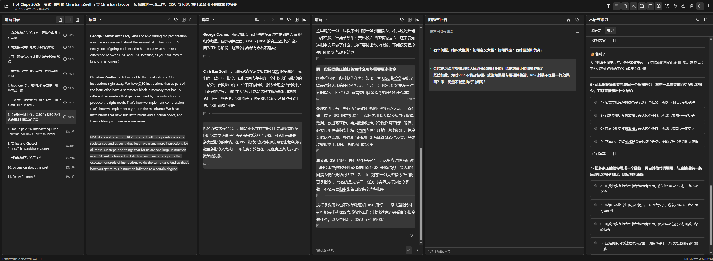
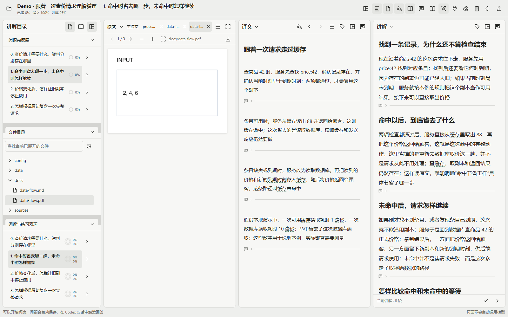
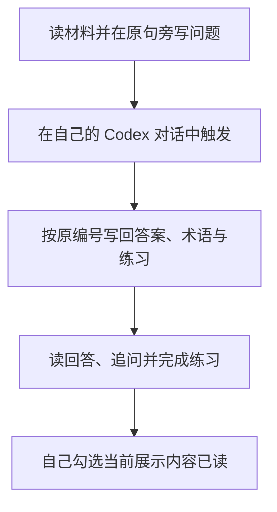

<div align="center">

<h1>ManualReader</h1>

<p>把原文、译文、讲解和自己的问题放在一起，读懂后留下能继续使用的记录</p>

[开始阅读](#2-怎样开始阅读) · [六区演示](#3-六个区域怎样配合) · [完整图册](docs/features.md) · [下载主分支源码](https://github.com/AIALRA-0/ManualReader/archive/refs/heads/main.zip) · [历史发行包](https://github.com/AIALRA-0/ManualReader/releases/latest) · [English](README.en.md)

</div>

<div align="center">



图 1 用户提供的实际硬件阅读页面；已裁去浏览器与网站地址，保留六栏真实内容与学习状态；下方分区截图另由官网只读连接取得

</div>

## 1 这套工作台怎样帮助你阅读

你先读材料，在卡住的原句旁写问题，再到自己的 Codex 对话中触发回答；阅读器保存来源、回答、术语、练习和你的理解，不要求先生成整篇讲义才能开始

- 目录把阅读内容安排成章节，显示手动阅读与练习进度
- 原文保留真实材料；译文按原编号对应，讲解另有位置，三者可以切换、分栏或上下拆分
- 点击一处内容可以找到另外两处的对应部分；问答保留自己的原句和追问关系
- 问题、理解笔记自动保存；每条问题只按自己的状态变色，未读或未答为黄色，已读但本题练习未做为青蓝色，已读且本题练习已做为绿色；子追问不影响主问题；新回答重新等待阅读
- 术语在各栏目独立设置显示方式；练习给出选择结果与具体解释，曾答错的题留在错题本中复习
- 手机通过标签切换栏目，图片、表格、公式和流程图可单独放大

## 2 怎样开始阅读

需要 Python 3.10 或以上版本和现代浏览器，首次安装依赖需要联网；在解压后的项目目录运行对应启动脚本

```powershell
# Windows：在当前目录创建独立环境并启动
.\Start-Reader.ps1
```

```sh
# Linux 或 macOS：在当前目录创建独立环境并启动
sh ./Start-Reader.sh
```

打开终端显示的本地地址；想体验上图中的完整场景，再在同一目录运行下面的命令，按终端打印的链接打开新建 Demo

```sh
# 创建独立的合成演示项目，不覆盖已有材料
python Demo/load_walkthrough.py --base http://127.0.0.1:8939
```

如果启动器使用其他端口，把命令中的端口改成它显示的端口；演示包含四章原文、译文、讲解、十二条问题与追问、术语和练习；内容预先写在仓库中，装载演示不调用模型，也不修改其他项目的笔记和已读进度

安装与备份见[部署说明](docs/deployment.md)，PDF、网页、PPT、仓库和空项目怎样进入阅读器见[导入说明](docs/importing.md)

## 3 六个区域怎样配合

### 3.1 目录怎样告诉你正在学什么

学习目录独立于原文件目录；换一份原件查资料时，当前学习路线仍然保留；你自己勾选当前展示内容已读，章节进度才会改变；目录顶部一个按钮可切换单项进度或内外双环

<div align="center">


图 2 真实项目的学习路线与已有进度；显示方式还可切换为外圈阅读、内圈练习的双环

</div>

### 3.2 原文、译文和讲解怎样对照

中间三栏分别展示材料本身、对应翻译与额外讲解；点击要核对的内容后，对应部分同步定位和高亮；普通滚动只负责阅读，不持续把另外几栏拉来拉去

<div align="center">


图 3 对着实际材料阅读，翻译忠实对应原文，额外讲解保留独立位置

</div>

### 3.3 问题怎样保留原句并继续追问

首次问题写在译文或讲解段落下面，输入会自动保存；回答集中进入问答栏，并把“原文”和“回答”分开；继续追问嵌入原问题下方，理解笔记与追问输入默认折叠，避免遮住正在读的内容

<div align="center">


图 4 同一条问题的来源、回答和追问保留在一起；每条问题的三角只结合本题的回答、阅读与练习状态更新

</div>

### 3.4 术语与练习怎样帮助复盘

术语保留定义和直观解释；各栏可以分别选择中英文全称、缩写等七种名称方式，也可以保留原词、悬停查看全称；练习围绕已讲清的内容核对判断，选错时说明错在哪里，错题本保留历史作答；自动核对默认关闭，开启后选中选项直接判定

<div align="center">


图 5.1 实际阅读时累积的术语，展开查看定义和直观解释


图 5.2 当前章节的实际练习；可自行开启自动核对，选中选项后直接判定

</div>

更多名称模式、删除确认、自动保存与加载状态见[分区操作图册](docs/features.md)

### 3.5 配色怎样按自己的习惯保存

设置页提供八套浅色与深色组合；可以收藏多套、指定默认组合，或修改七类高亮和进度颜色后保存为自己的方案；已有颜色会保留，切换方案由你决定

<div align="center">


图 5.3 官网现有设置页；收藏可以多选，默认组合只选一套

</div>

### 3.6 怎样查阅项目里的任意文件

每个项目都有独立的文件根目录，默认位置可以在设置里修改；文件目录与学习目录共享左栏，在标题菜单里切换讲解目录、原文目录、阅读进度、练习进度、双环和文件目录，并拆成上下两窗或三窗；文件树包含隐藏文件，并自动同步物理目录变化；右键可以管理文件，也能拖动上传

点击文件后，原文栏会打开可关闭、可拖动排序的标签；不可关闭的“主原文”继续承接阅读映射，点击讲解或问题中的映射就自动返回；普通文件标签保留，查资料不会改变章节或已读进度；窄栏把原文工具收进菜单，文件窗口也可单独放大

<div align="center">

<picture>
  <source media="(prefers-color-scheme: dark)" srcset="docs/assets/readme/project-files-dark.png">
  
</picture>

图 5.4 文件树与阅读路线同时保留，普通标签正在查看三页 PDF；此图由自撰合成项目在实际阅读器中截图，物理路径已脱敏

</div>

常见代码、Markdown、图片、表格、音视频和文档都有对应预览；办公原版式使用本机 LibreOffice，其他二进制可看文件信息与字节并下载；[支持范围、项目权限和 Agent 文件接口](docs/project-files.md)有完整说明

讲解中的本地文件链接直接在原文栏打开标签；提问时匹配的问法以浅色后缀显示，上下键切换、Tab 接受，手机可点“补全”，不弹出下拉菜单；任意层级的问答共用互斥展开规则，同一时间只打开一道问题

```sh
# 在已启动的本机阅读器中新建独立文件演示，不调用模型
python Demo/load_project_files.py --base http://127.0.0.1:8939
```

本功能位于最新主分支；命令创建新 Demo，保留所有旧项目与学习记录

## 4 手机上怎样阅读

手机使用底部标签切换原文、译文、讲解、问答和术语练习，当前栏目占满可用宽度；问题仍对应同一份材料，不另建一套移动端记录

<div align="center">


图 6 同一真实项目在 390 像素宽度下的实际界面，使用浏览器视口模拟

</div>

问题可以使用自行部署的离线语音服务输入，录音时显示状态，转写文字仍可修改；安装和识别限制见[离线语音说明](docs/offline-voice.md)

## 5 Agent 怎样接上你的阅读过程

在页面点击连接按钮，把当前项目的连接说明交给自己的 Codex 对话；Agent 通过项目接口读问题、取得原句并写回内容，对话仍由你手动触发

<div align="center">



图 7 网页负责展示和记录，学习推进由用户控制

</div>

连接限定一个项目，Agent 不代替用户改笔记、练习作答或手动进度；删除问题或回答需要先读取预览，再核对原话、版本和受影响追问后确认；字段、客户端与写作规则见[Agent 接口说明](docs/agent-api.md)

## 6 性能与稳定性怎样验证

当前运行路径复用已经算出的章节信息，恢复阅读位置时减少重复重建译文；章节统计先累计总数和已读数，再取得各章范围的计数，避免每章重新扫描全部段落；发行包移除了启动器不再使用的旧界面副本和拼接脚本

本版 99 项确定性测试通过；此前真实大项目通过正常 HTTPS 与登录链路交替复测，每项目每版 48 次切章；EXAM2 中位数 756 → 626 ms、P95 2037 → 1386 ms，访谈中位数 511 → 422 ms、P95 670 → 540 ms；这些是此前的基准测量值，详细条件与最大值在性能记录中

确定性测试和实际浏览器检查覆盖删答改题、跨章节写回、服务重启、阅读完成、双环进度和自动核对；大项目使用 2271 个片段的 EXAM2 与累积数十条追问的访谈项目，测试副本保留全部内容规模；结果、条件及复现方法见[测试记录](docs/validation.md)和[性能记录](docs/performance.md)

回答和讲解共用公开的[写作规则](reader_prompts.py)；需要材料之外的名称来历、历史或规格时主动检索权威来源，再围绕问题给出明确答案；本版的跨领域对照、耗时和用量见[写作测试记录](docs/writing-quality.md)

## 7 数据和许可怎样处理

公开仓库包含程序、必要依赖、合成示例和经审核的实际使用截图；截图不带网站地址、连接信息或笔记；项目资料、数据库、配对凭据、录音和模型权重不随代码导出；升级前备份数据，更新程序时保留已有阅读目录

本地默认绑定回环地址；对外部署需要 HTTPS、登录保护和项目授权；项目源码尚未另行指定许可证，依赖的许可与来源见[第三方说明](THIRD_PARTY_NOTICES.md)
