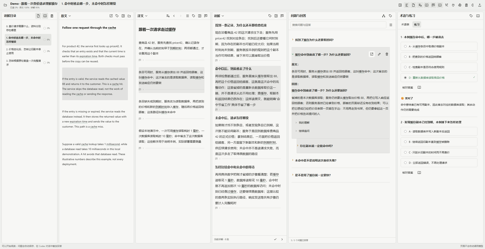
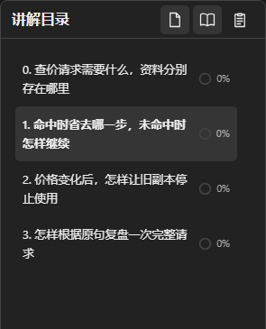
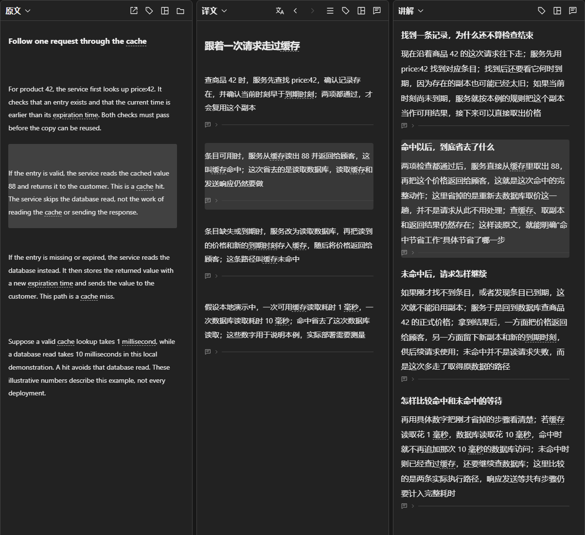
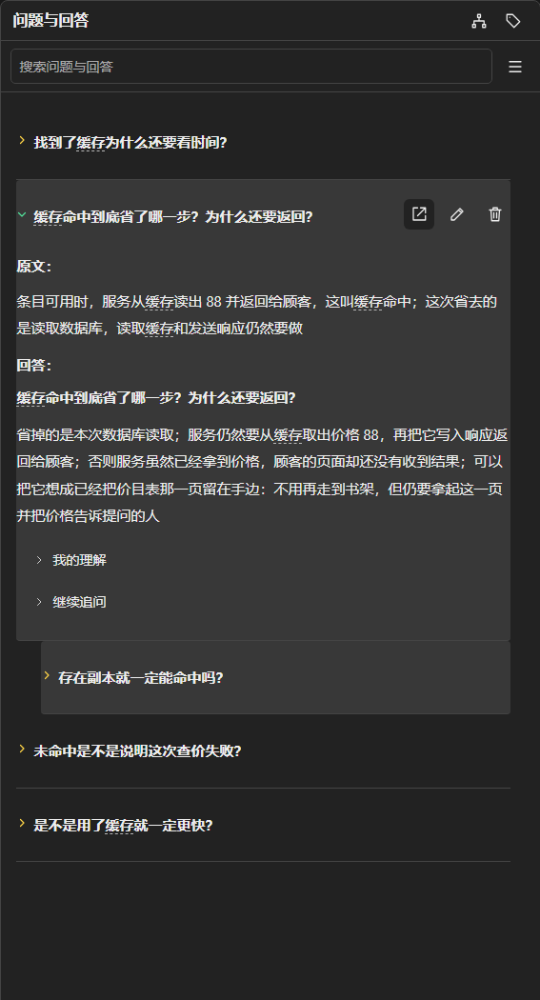
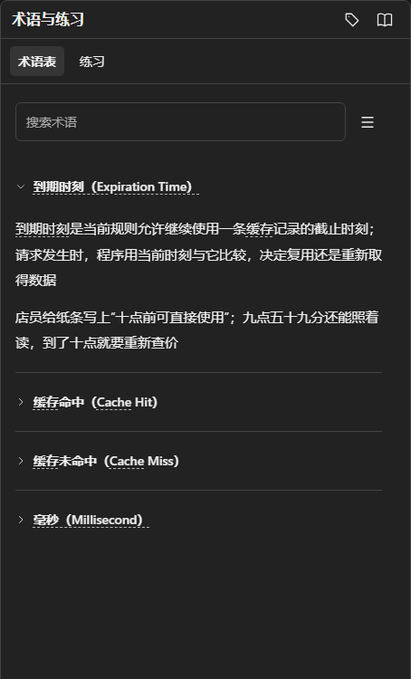
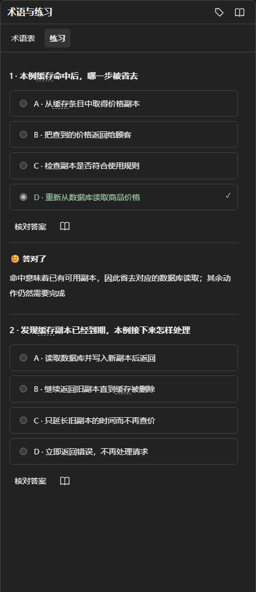
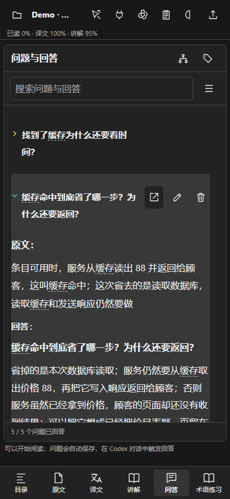
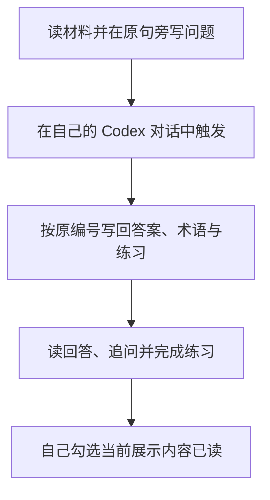

<div align="center">

<h1>ManualReader</h1>

<p>把原文、译文、讲解和自己的问题放在一起，读懂后留下能继续使用的记录</p>

[开始阅读](#2-怎样开始阅读) · [六区演示](#3-六个区域怎样配合) · [完整图册](docs/features.md) · [下载部署包](https://github.com/AIALRA-0/ManualReader/releases/latest) · [English](README.en.md)

</div>

<div align="center">

<picture>
  <source media="(prefers-color-scheme: dark)" srcset="docs/assets/readme/workspace-dark.png">
  
</picture>

图 1 实际运行的六区阅读工作台，使用自撰查价文章和固定合成问答；原文、译文和讲解正在高亮同一步，右侧显示追问与练习反馈

</div>

## 1 这套工作台怎样帮助你阅读

你先读材料，在卡住的原句旁写问题，再到自己的 Codex 对话中触发回答；阅读器保存来源、回答、术语、练习和你的理解，不要求先生成整篇讲义才能开始

- 目录把阅读内容安排成章节，显示手动阅读与练习进度
- 原文保留真实材料；译文按原编号对应，讲解另有位置，三者可以切换、分栏或上下拆分
- 点击一处内容可以找到另外两处的对应部分；问答保留自己的原句和追问关系
- 问题、理解笔记自动保存；新回答显示黄色三角，展开后变绿，更新后重新等待阅读
- 术语在各栏目独立设置显示方式；练习给出选择结果与具体解释，曾答错的题留在错题本中复习
- 手机通过标签切换栏目，图片、表格、公式和流程图可单独放大

## 2 怎样开始阅读

需要 Python 3.10 或以上版本和现代浏览器，首次安装依赖需要联网；在解压后的项目目录运行对应启动脚本

```powershell
# Windows：在当前目录创建独立环境并启动
.\Start-Reader.ps1
```

```sh
# Linux 或 macOS：在当前目录创建独立环境并启动
sh ./Start-Reader.sh
```

打开终端显示的本地地址；想体验上图中的完整场景，再在同一目录运行下面的命令，按终端打印的链接打开新建 Demo

```sh
# 创建独立的合成演示项目，不覆盖已有材料
python Demo/load_walkthrough.py --base http://127.0.0.1:8939
```

如果启动器使用其他端口，把命令中的端口改成它显示的端口；演示包含四章原文、译文、讲解、十二条问题与追问、术语和练习；内容预先写在仓库中，装载演示不调用模型，也不修改其他项目的笔记和已读进度

安装与备份见[部署说明](docs/deployment.md)，PDF、网页、PPT、仓库和空项目怎样进入阅读器见[导入说明](docs/importing.md)

## 3 六个区域怎样配合

### 3.1 目录怎样告诉你正在学什么

学习目录独立于原文件目录；换一份原件查资料时，当前学习路线仍然保留；你自己勾选当前展示内容已读，章节进度才会改变

<div align="center">



图 2 目录同时保留学习顺序、当前章节和阅读进度；图中的演示尚未勾选已读

</div>

### 3.2 原文、译文和讲解怎样对照

中间三栏分别展示材料本身、对应翻译与额外讲解；点击要核对的内容后，对应部分同步定位和高亮；普通滚动只负责阅读，不持续把另外几栏拉来拉去

<div align="center">



图 3 同一句“命中后返回缓存值”在原文、译文和讲解中的对应；讲解继续解释这次省掉了什么动作

</div>

### 3.3 问题怎样保留原句并继续追问

首次问题写在译文或讲解段落下面，输入会自动保存；回答集中进入问答栏，并把“原文”和“回答”分开；继续追问嵌入原问题下方，理解笔记与追问输入默认折叠，避免遮住正在读的内容

<div align="center">



图 4 同一条问题的来源、回答和追问保留在一起；展开过的回答变绿，未展开的追问仍为黄色

</div>

### 3.4 术语与练习怎样帮助复盘

术语保留定义和直观解释；各栏可以分别选择中英文全称、缩写等七种名称方式，也可以保留原词、悬停查看全称；练习围绕已讲清的内容核对判断，选错时说明错在哪里，错题本保留历史作答

<div align="center">



图 5.1 术语的定义与直观解释沿用同一个查价案例



图 5.2 选择题核对刚读过的判断，并解释所选答案

</div>

更多名称模式、删除确认、自动保存与加载状态见[分区操作图册](docs/features.md)

## 4 手机上怎样阅读

手机使用底部标签切换原文、译文、讲解、问答和术语练习，当前栏目占满可用宽度；问题仍对应同一份材料，不另建一套移动端记录

<div align="center">



图 6 同一合成项目在 393 像素宽度下的实际界面，使用浏览器视口模拟

</div>

问题可以使用自行部署的离线语音服务输入，录音时显示状态，转写文字仍可修改；安装和识别限制见[离线语音说明](docs/offline-voice.md)

## 5 Agent 怎样接上你的阅读过程

在页面点击连接按钮，把当前项目的连接说明交给自己的 Codex 对话；Agent 通过项目接口读问题、取得原句并写回内容，对话仍由你手动触发

<div align="center">



图 7 网页负责展示和记录，学习推进由用户控制

</div>

连接限定一个项目，Agent 不代替用户改笔记、练习作答或手动进度；删除问题或回答需要先读取预览，再核对原话、版本和受影响追问后确认；字段、客户端与写作规则见[Agent 接口说明](docs/agent-api.md)

## 6 性能与稳定性怎样验证

当前运行路径复用已经算出的章节信息，恢复阅读位置时减少重复重建译文；章节统计先累计总数和已读数，再取得各章范围的计数，避免每章重新扫描全部段落；发行包移除了启动器不再使用的旧界面副本和拼接脚本

三十六项合成单元测试已通过，浏览器也实际走过删答改题、按原编号写回及加载失败恢复，桌面和手机布局分别检查；结果、条件及复现方法见[测试记录](docs/validation.md)和[性能记录](docs/performance.md)

## 7 数据和许可怎样处理

公开仓库只包含程序、必要依赖、合成材料和截图，不包含个人阅读资料、数据库、配对凭据、录音或模型权重；升级前备份数据，更新程序时保留已有阅读目录

本地默认绑定回环地址；对外部署需要 HTTPS、登录保护和项目授权；项目源码尚未另行指定许可证，依赖的许可与来源见[第三方说明](THIRD_PARTY_NOTICES.md)
