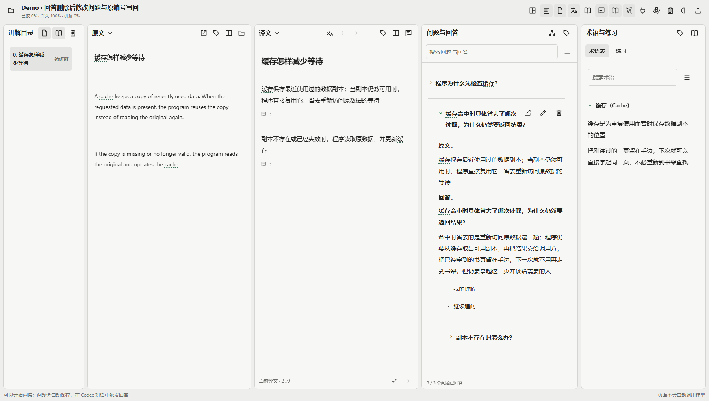
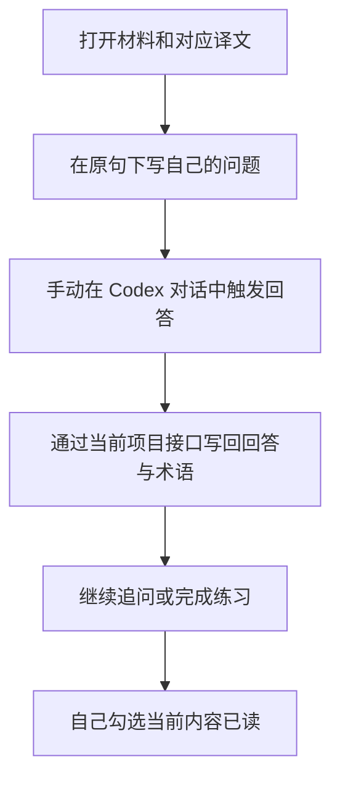
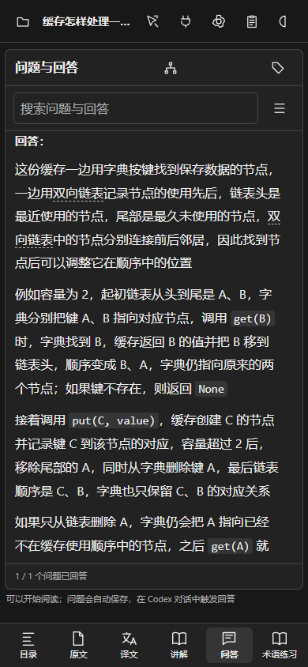
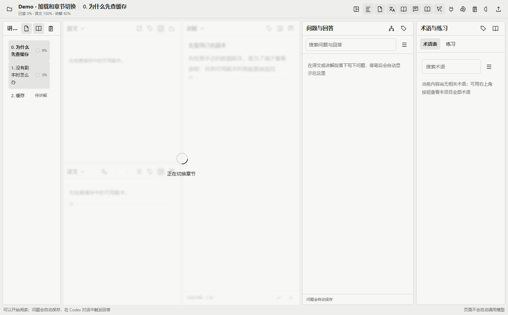

<div align="center">

<h1>ManualReader</h1>

<p>读原文、对照译文，把自己的问题和理解留在原句旁</p>

[开始使用](#2-怎样开始阅读) · [阅读流程](#3-怎样读完一段) · [接口说明](docs/agent-api.md) · [English](README.en.md)

</div>

<div align="center">

<picture>
  <source media="(prefers-color-scheme: dark)" srcset="docs/assets/readme/question-roundtrip.png">
  
</picture>

图 1 当前版本的实际界面，固定合成回答展示原文对应、三层追问和回答阅读状态

</div>

## 1 这个阅读器帮助谁做什么

ManualReader 适合需要对照材料、反复追问并保存理解过程的读者

你先读原文和译文，在段落下面写问题；再由你自己的 Codex 对话读取问题、解释、保存术语和练习，网页负责展示与记录，不会自动开始生成整套讲义

- 原文、译文和讲解可以切换、分栏，也可以在同一栏上下排列
- 问题关联真实段落，追问保留父问题，理解笔记和练习结果一起保存
- 术语共用登记，五个栏目各自设置七种命名方式，默认悬停显示完整名称，不改原词
- PDF 保留原页和定位，Markdown 支持公式、表格、代码、图片与流程图
- 手机上通过标签切换栏目，桌面上可以拖动调整分栏
- 语音输入可以使用自行部署的离线服务，录音时显示停止按钮与计时，转写后仍可编辑文字
- 理解笔记自动保存；错过的题留在错题本中，答对后仍可复习，用户手动移出时保留原作答记录
- 回答用三角颜色区分未读与已读；更新后的回答重新变黄，展开后变绿，刷新后保留
- 删除问题或回答先弹窗核对；Agent 删除还需要一次性预览确认，原问题编号和历史继续保留
- 较慢的读取显示轻微模糊、转圈和真实处理阶段，失败后恢复可操作状态
- 图片、表格、公式和流程图可以点击放大；写作者按需要引用原图、画流程图或实际生成新插图

代码项目和没有原件的学习任务也可以使用：让 Agent 写入章节讲解，再围绕讲解阅读和提问

## 2 怎样开始阅读

需要 Python 3.10 或以上版本，首次安装解析器依赖需要联网，浏览器需要支持现代 JavaScript

- 第一步，下载仓库，在仓库目录打开终端
- 第二步，按系统运行启动脚本，脚本会在当前目录创建独立 Python 环境，不修改系统依赖

```powershell
# Windows：创建本目录的独立环境并启动阅读器
.\Start-Reader.ps1
```

```sh
# Linux 或 macOS：创建本目录的独立环境并启动阅读器
sh ./Start-Reader.sh
```

- 第三步，打开终端显示的本地地址，通常为 `http://localhost:8939`；首页显示的是仓库自带的合成缓存案例
- 第四步，导入自己的文件或网址，或者先用演示内容试着提一个问题

要查看截图中的实际模型回答，可在仓库目录运行 `python Demo/load_example.py --base http://127.0.0.1:8939`；如果启动时显示其他端口，按显示的地址修改参数，这一步只写入合成演示项目

不同材料怎样解析、怎样保留定位，见[导入说明](docs/importing.md)；安装、端口和数据迁移见[部署说明](docs/deployment.md)

## 3 怎样读完一段

<div align="center">



图 2 阅读由用户推进，网页保存上下文，Agent 不代替用户标记已读

</div>

点击连接按钮，把页面提供的说明复制到自己的 Codex 对话，Agent 就能取得当前项目的接口和写作规则

每条回答把原文和解释分开显示，理解笔记与继续追问默认折叠；回答、术语和练习按轮次累加，已有笔记不会因下一次回答而清空

<div align="center">



图 3 手机使用标签切换栏目，当前栏目保留完整宽度

</div>

## 4 Agent 怎样写回内容

连接按项目授权，接口使用稳定的文件、段落、句子和问题编号

- 读取问题池和原句，按当前任务准备回答
- 按原编号写回译文，保留标题、段落和句级对应
- 写入独立讲解，同时关联章节和原文
- 保存回答、可复用术语和选择题，保持追问层级
- 只在用户手动勾选完成后推进学习章节

调用示例和字段约束见[Agent 接口说明](docs/agent-api.md)，自行部署的鉴权与配对见[部署说明](docs/deployment.md)

## 5 语音和配图怎样工作

语音试点使用 SenseVoice 的量化 ONNX 模型，通过 sherpa-onnx 在自己的电脑或服务器上运行，录音不发送给云端转写服务；首次需要下载模型，运行时还需要 FFmpeg

点击问题框旁的麦克风，讲话后再次点击结束，转写结果进入当前问题框，仍可继续修改；录音仅在请求内存中处理，不作为阅读资料保存

安装方式、识别限制和合成录音测试见[离线语音说明](docs/offline-voice.md)

回答优先复用真实原图，适合说明多步关系时可以生成 Mermaid 流程图；只有现有图和流程图都不足以表达时，才请求新的插图，图片生成依赖所连接 Codex 的实际工具能力

## 6 哪些内容经过了测试

检查覆盖回答换行、默认折叠、术语七种命名方式、歧义别名、公式与代码保护、实际图片引用、桌面和手机布局

新增回归走完回答、删除回答、修改问题、读取默认待答池和按原编号写回，检查三层追问、笔记、练习和手动进度继续保留；还检查删除确认的项目限制、有效期、内容变化和重复提交

<div align="center">



图 4 暂停实际章节请求后观察到的加载状态，完成或出错后会恢复

</div>

更多删除弹窗、手机界面和加载效果见[功能图册](docs/features.md)，可复现的测试与限制见[测试记录](docs/validation.md)

提示词用数学、计算机结构、缓存、渗透、请求重试、概率和温控材料做小量对照，模型使用 Terra high 普通服务；结果与测量范围见[测试记录](docs/validation.md)

语音目前属于试点，普通中文问题和长追问可以使用，专业英文名称仍可能识别错误；用户可以保留原句关联，只口述“这个函数为什么这样写”，再修改转写中的专有名称

## 7 数据怎样保存，公开仓库里有什么

公开仓库只包含程序、必要的前端依赖、合成演示和测试说明，不包含真实阅读材料、问答数据库、配对信息、录音或模型权重

个人阅读数据保存在运行目录，迁移或升级前应复制整个数据目录；默认本地服务绑定回环地址，对外部署需要 HTTPS、登录保护和单独的项目配对

发现问题时，可以在本仓库提交 Issue，附上合成材料和复现步骤，不要公开自己的原件、连接码或阅读记录

本仓库尚未为项目源码指定许可证，第三方组件的许可与来源见[第三方说明](THIRD_PARTY_NOTICES.md)
