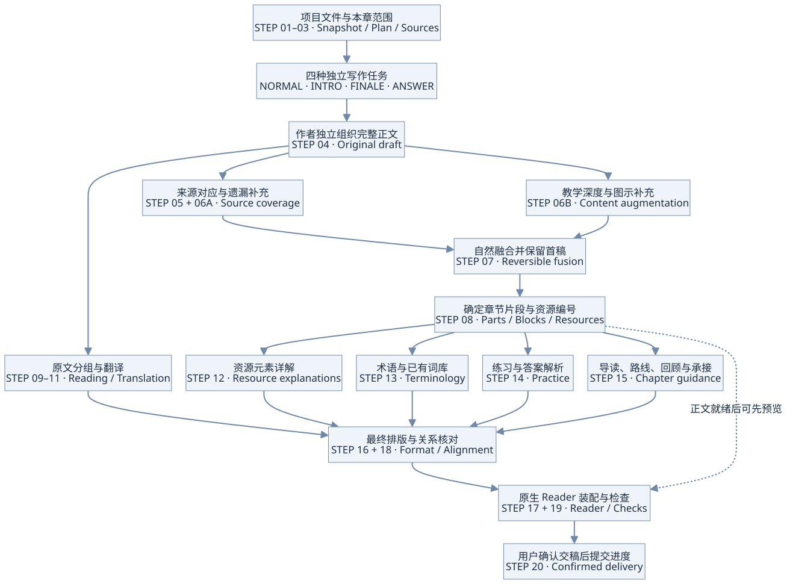

# 1 一份材料怎样变成可阅读的章节

当前程序由两部分组成：`reader/` 提供项目、原件、阅读界面、问答、术语、练习与保存接口；`next/src/manualreader/` 提供当前规划、写作和后处理

两者共同服务同一个 Reader，不再给用户提供另一套生成模式页面

冻结提示词保存在 `next/src/manualreader/stages/` 与 `next/src/manualreader/steps/prompts/`

更改文件位置时应核对提示词原始内容，不能顺便改写已验收的 Writer 指令

## 1.1 各步骤负责什么

表 1 · 步骤职责与主要实现位置

| 步骤 | 实际职责 | 实现位置 |
| --- | --- | --- |
| 01 | 扫描项目文件，记录版本和历史进度，提交前重新对账 | `stages/step01/` |
| 02 | 按 INTRO、NORMAL、FINALE、ANSWER 生成宏观任务卡 | `stages/step02/` |
| 03 | 解析原件，恢复可读取的文字与非文字资源 | `stages/step03/` |
| 04 | 使用当前模式的冻结 Writer 提示词完成首稿 | `stages/step04/` |
| 05–06 | 首轮来源映射、遗漏补充、教学深度和资源补充 | `stages/step05/`、`stages/step06/` |
| 07 | 融合补丁并保留修改记录，原样首稿继续保存 | `stages/step07/` |
| 08 | 建立 Part、Block 与资源身份，重映射已有锚点 | `stages/finish/` |
| 09–11 | 原文阅读分组、原文翻译、图中文字翻译 | `steps/`、`stages/finish/` |
| 12–15 | 资源详解、术语、练习、章首章末与阅读路线 | `steps/`、`stages/finish/` |
| 16–18 | 安全格式、Reader 装配和关系收口 | `stages/finish/`、`stepfinal_server.py` |
| 19–20 | 全链检查、版本化交稿与进度提交 | `steps/`、`stepfinal_server.py` |

步骤编号用于表达责任，不表示每篇都必须串行执行 20 次模型请求

来源读取、缓存、定位、排版、装配和保存主要由脚本完成；资源和附件按实际内容合批

## 1.2 哪些任务可以同时开始

图 1 · 写作与后处理的实际依赖

当前连接入口在 `reader/reader_bridge.py`，章节实现委托给 `reader/reader_next_teach.py`

首稿返回后，`manualreader.connected` 继续处理后续步骤，翻译与映射、补充可以重叠

结构就绪后，资源、术语、练习与章节附件按各自依赖启动

批量执行器 `next/tools/run_whiteboard.py` 管理多篇独立任务，也支持提前准备来源相关内容

单篇中的必要依赖仍按顺序执行，不会因为另一篇尚未完成而设置整批等待

这里没有承诺所有入口都已经把翻译提前到 Writer 之前

读者实际使用的连接 `teach` 在 Writer 之后启动翻译；运行记录才是判断某一次并行效果的依据

## 1.3 哪些身份需要一直保留

原件保留文件 ID、版本和真实来源编号；正文保留章节、Part、Block 和资源身份

两组主要关系为 S–T 与 S–E，反向索引由脚本生成

没有来源证据时不编造关联，也不通过删掉分母来制造覆盖率

导航归属帮助读者定位，实质讲解覆盖用于判断材料是否真正讲过，两者不能混为一谈

译文处理允许“明确保留原文”这一有效结果，失败与尚未处理仍是未完成

## 1.4 什么会修改用户数据

生成过程在本轮工作目录保留原始模型响应、首稿、补丁、媒体和回执

阅读预览可以挂入讲解栏，但不会替用户勾选手动完成

正式交稿需要用户确认，并在提交前重新核对原件版本

项目文件权限、真实 ID、版本和文件边界由脚本检查

程序不以语义评分决定一篇文章是否“讲清楚”，也不增加反复审稿循环

外部服务错误需要记录和恢复，不能把未完成内容报告为已完成

## 1.5 怎样修改代码而不改变正文

界面与项目接口修改集中在 `reader/`；后处理修改集中在 `next/`

运行根目录的统一回归测试后，再在独立实例检查当前客户端和浏览器行为

默认启动使用 `scripts/serve_reader.py`，它装配与生产相同的 Next 静态适配层

完整连接流程见 [Agent 说明](agent-connection.md)，部署和实际运行边界见 [部署说明](next-deployment.md)

历史实验和旧规范保存在 `Demo/`，不能拿旧文档的入口替代当前连接合同
