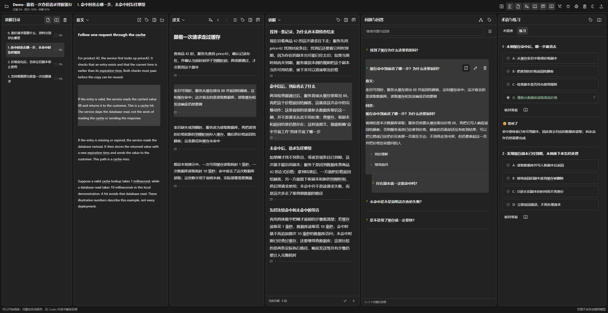
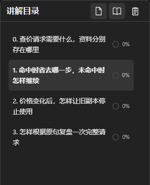
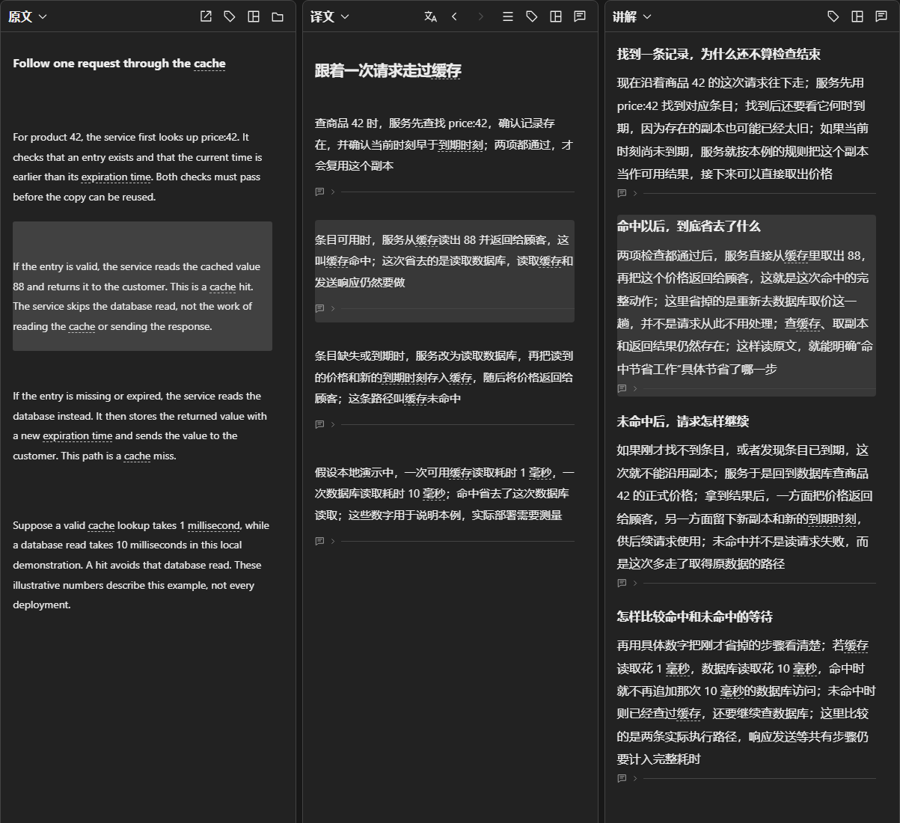
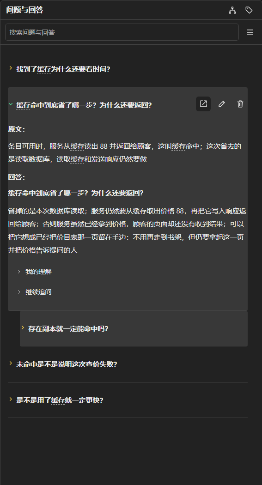
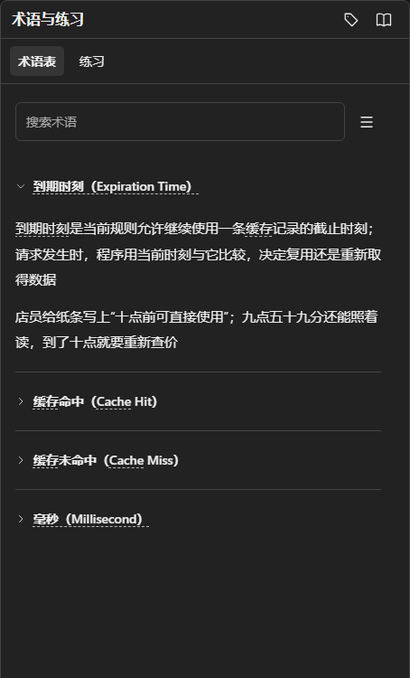
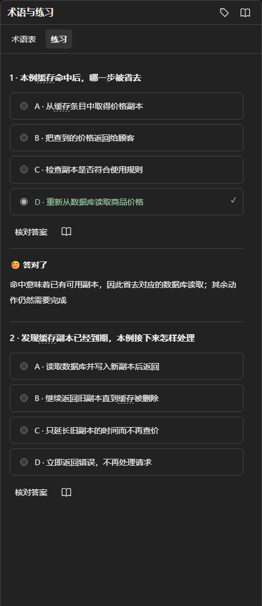
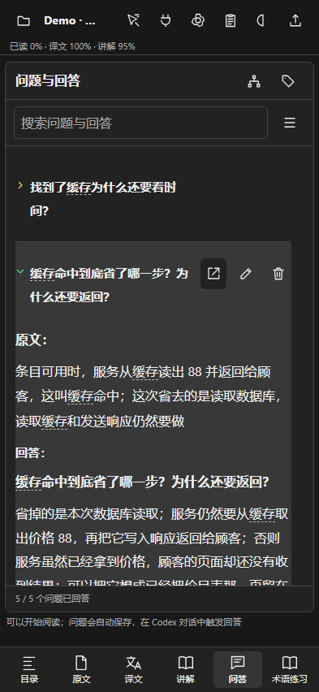

# 1 怎样打开完整阅读场景

启动阅读器后，在项目目录运行下面的命令；端口改为启动器实际显示的端口，再打开命令打印的新 Demo 链接

~~~sh
# 将合成资料装入一个独立的新项目
python Demo/load_walkthrough.py --base http://127.0.0.1:8939
~~~

这份自撰文章沿同一个商品 42 解释查价、命中、未命中与改价后的处理，四章内容和十二条固定问答都可直接阅读；装载演示不调用模型，不改其他项目

图 1 实际运行的合成阅读场景，原文、译文与讲解正在对应同一段内容

# 2 目录怎样保留学习路线

点击目录章节，会切换负责的原文范围、译文、讲解和相关问题；切换原文文件查资料时，主学习目录仍然独立；章节进度只由用户勾选当前展示内容已读后改变，回答的绿三角单独记录是否展开过

图 2 演示没有勾选章节已读，写入讲解与答案不会替用户完成阅读

# 3 三种内容怎样对应起来

点击“条目可用时，服务从缓存读出 88”这一段，在原文核对动作，在译文读中文，在讲解弄清省去了哪一步；普通滚动不主动改定位；需要看上下文时可以切到完整译文范围

图 3 缓存命中过程的三处对应，额外讲解不混入译文

# 4 问题怎样留下来源并继续追问

首次问题在译文或讲解段落下输入并自动保存，回答集中进入问答栏，原文与回答分开显示；继续追问放在对应问题下，理解笔记与输入框默认折叠；编辑问题后保留原编号，旧回答不会把新问题漏出待答池

图 4 “存在副本就一定能命中吗”仍挂在缓存命中的问题下，未展开的追问保持黄色

# 5 术语怎样解释，名称怎样切换

点击栏目右侧标签图标，只调整当前栏的名称显示；可使用七种命名模式，也可以保留原词、悬停查看名称；术语展开后保留定义与具体直观解释，同一概念继续复用

图 5 显示方式由脚本切换，术语记录和原句不改写

# 6 练习怎样反馈，错题怎样保留

选一项再核对，页面显示结果和具体解释；选错的题进入错题本，复习答对后仍保留，用户可以手动移出；原练习作答与复习记录分别保存

图 6 第一题检查命中省掉的步骤，下一题检查到期后怎样处理

# 7 手机上怎样阅读

底部标签切换原文、译文、讲解、问答与术语练习，当前栏目使用手机可用宽度，记录仍归属于同一个项目；问题旁的语音按钮可连接自行部署的转写服务，配置见[离线语音说明](offline-voice.md)

图 7 同一合成项目在 393 像素视口中的实际界面，使用浏览器模拟

# 8 删除和加载怎样反馈

删除前用弹窗核对问题原话和影响范围，Agent 还需一次性预览确认；读取较慢时内容区轻微模糊，显示转圈和真实阶段，结束或出错后恢复操作

图 8 删除操作先核对对象，取消后保持原记录

图 9 加载阶段来自真实请求状态，没有填写虚构的百分比

测试条件见[测试记录](validation.md)，性能与复现方法见[性能记录](performance.md)
