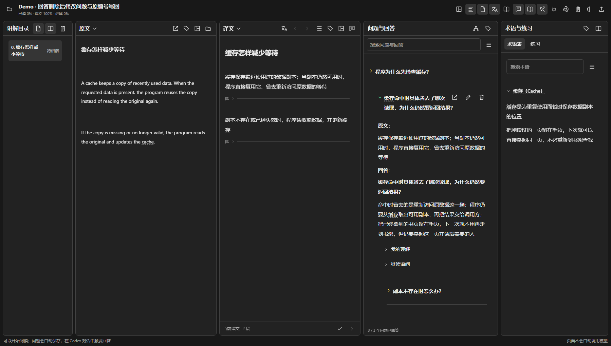
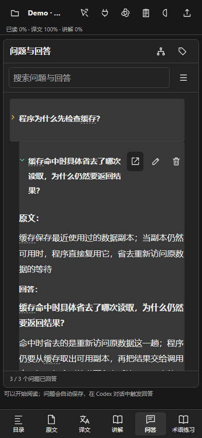
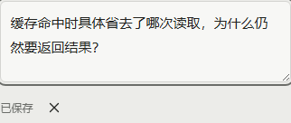

# 1 怎样对照材料阅读和追问

原文、译文和讲解各有独立位置，问题始终保留自己的原句与父问题；桌面可以拖动分栏，手机通过底部标签使用当前一栏的完整宽度

图 1 当前版本的桌面问答，所有内容均为合成缓存案例，回答用固定文本写入，未调用模型

图 2 手机栏目保留完整宽度；这是浏览器视口测试，不代表所有实体手机都已测试

# 2 删除前怎样核对，保存后怎样看状态

删除按钮打开统一弹窗，显示将要删除的问题，并说明是否包含追问；取消不会修改回答。问题编辑后自动保存，保存提示与收起按钮在同一行

图 3 删除确认使用真实弹窗，Agent 接口另有一次性预览确认

图 4 自动保存后的编辑状态，原问题编号继续保留

回答三角为黄色时表示当前版本尚未展开，为绿色时表示已经展开；修改回答后重新变黄。这个状态单独保存，不改变章节手动已读进度

# 3 读取时怎样知道页面仍在工作

较慢的材料读取或章节切换会让内容区轻微模糊，并显示转圈和当前真实阶段；快请求延迟显示，避免一闪而过。请求失败后遮罩解除，用户仍可继续操作

图 5 通过暂停真实读取请求观察加载状态，没有填写虚假的百分比

术语各栏独立选择名称方式，图片、公式与表格支持放大，错题本保留曾经答错的题，语音转写后仍可修改；这些功能的实际限制见[测试记录](validation.md)与[语音说明](offline-voice.md)
