# 1 先看实际使用中的六栏

首页使用用户提供的硬件访谈截图；下面的分区和手机截图来自官网当前项目，截图连接禁止写入，未更改原记录；原始访谈来自 Chips and Cheese，保留页面中的作者与受访者署名

<picture>
  <source media="(prefers-color-scheme: dark)" srcset="assets/readme/actual-workspace-dark.png">
  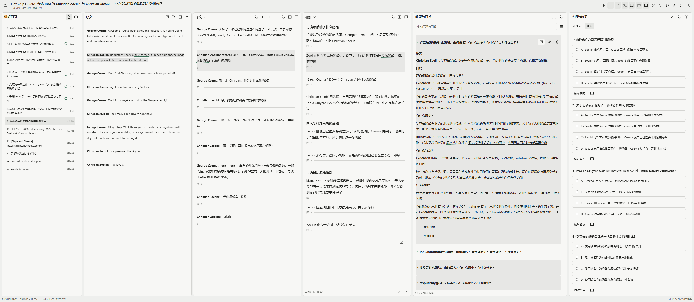
</picture>

图 1 实际硬件阅读中的原文、译文、讲解、问题和练习

# 2 目录怎样显示路线与完成度

学习目录和原文件目录各自保留；顶部一个按钮可选择阅读完成度、练习完成度或双环；双环外圈与上排数字表示阅读，内圈与下排数字表示练习；只有用户手动勾选才改变阅读完成度

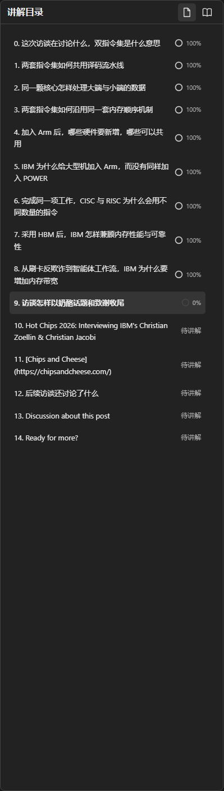

图 2 真实访谈的学习目录与已有阅读进度

# 3 三种内容怎样对照

原文展示材料本身，译文保留中文对应，讲解补充理解；点击明确选择一处内容后，另外两栏定位到对应部分，普通滚动不主动触发跳转

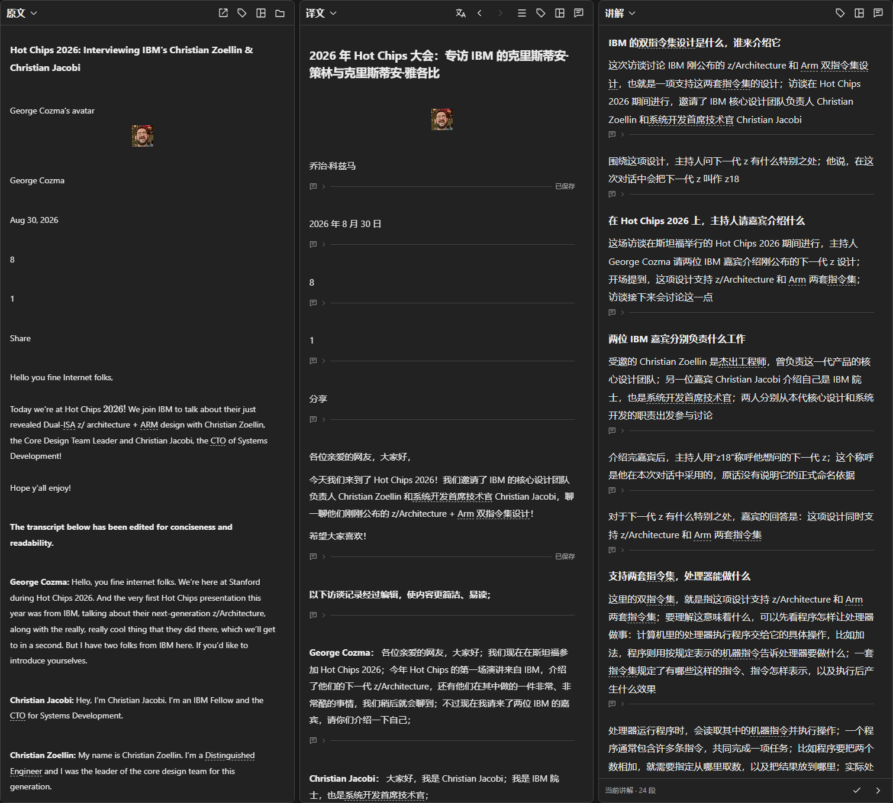

图 3 真实访谈中的三栏内容与灰色对应高亮

# 4 问题怎样保留原句和多轮追问

首次问题在译文或讲解的段落下填写并自动保存；问答栏保留原句、回答和缩进追问，未回答时不提前显示继续追问框；理解笔记和追问输入默认折叠

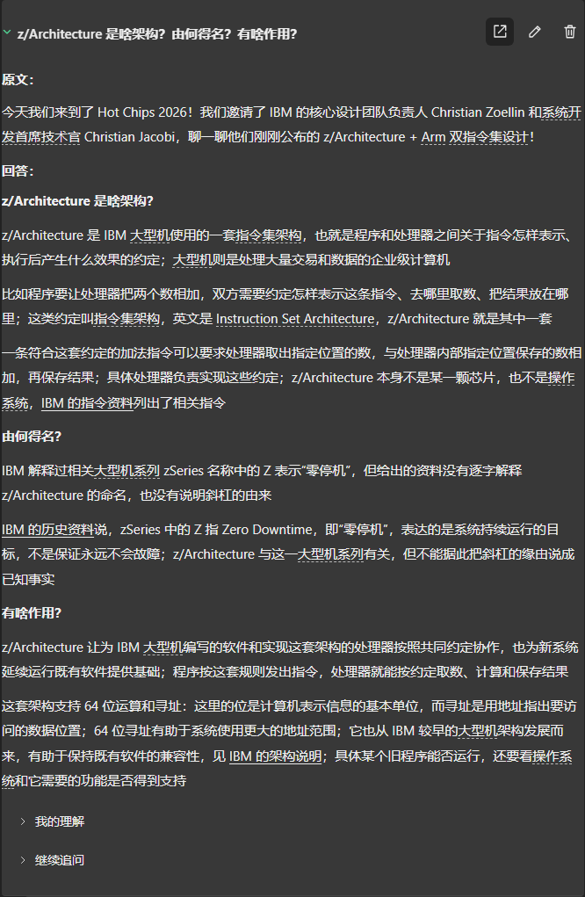

图 4 原句、回答与多轮追问保留在一起

# 5 术语怎样积累并解释

同一术语复用编号，展开后显示定义与直观解释；原文、译文、讲解、问答和练习分别设置名称方式，可保留原词并悬停查看全称

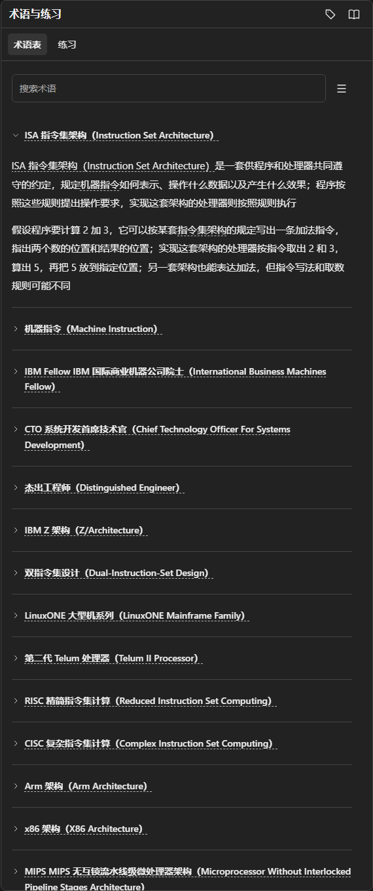

图 5 真实阅读中已经积累的术语与展开解释

# 6 练习怎样核对与复习

默认选择后再核对；右上角自动核对按钮开启后，一选就显示判断与解析；曾经答错的题保存在错题本，用户可以手动整理

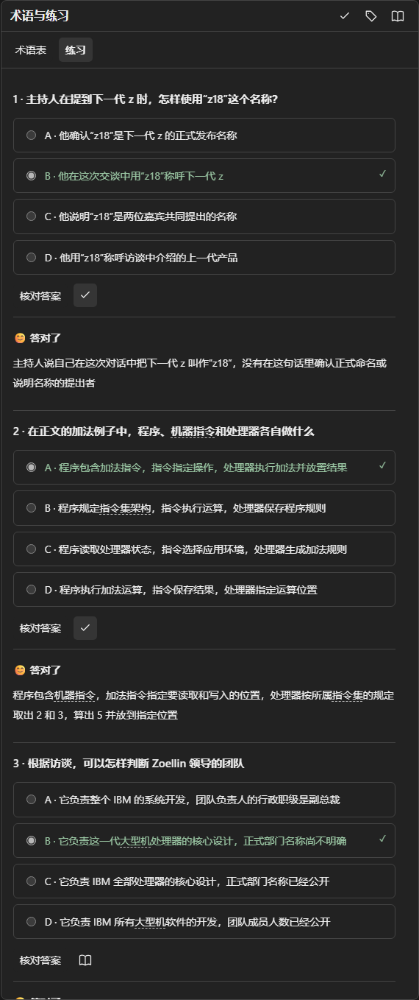

图 6 当前章节的实际练习和核对入口

# 7 手机怎样保留同一份记录

手机用底部标签切换各栏，问题、术语和练习仍属于同一项目；图中使用 390 像素浏览器视口，不把桌面多栏挤到一屏

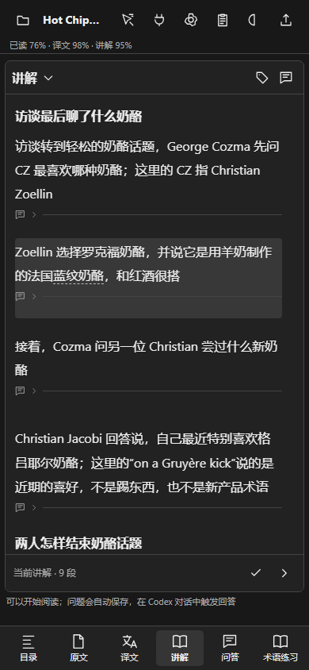

图 7 同一真实项目的手机讲解界面

# 8 双环和自动核对怎样切换

双环显示方式和自动核对都可关闭，设置刷新后保留；两张局部操作图使用隔离的合成资料，操作不会改到真实项目

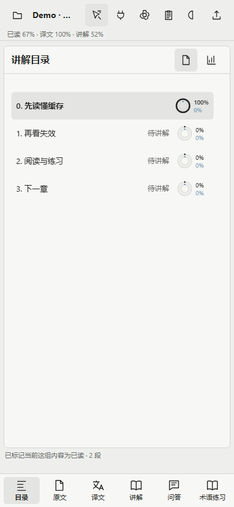

图 8 手机上切换目录进度模式

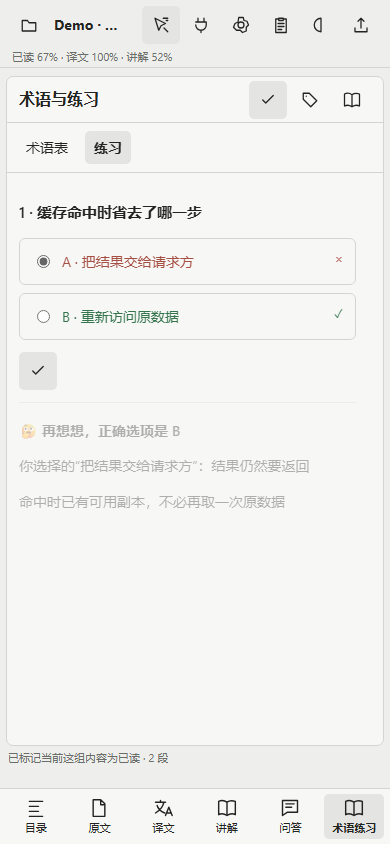

图 8.1 自动核对保持默认关闭，用户可以随时开启

# 9 怎样在本地装载可重复的示例

下面命令建立一个独立的四章查价示例，保留十二条固定问答与追问；示例无需调用模型，也不覆盖其他项目

~~~sh
# 端口使用启动器实际显示的值
python Demo/load_walkthrough.py --base http://127.0.0.1:8939
~~~

[删除、连接与写回接口](agent-api.md) · [测试记录](validation.md) · [性能记录](performance.md) · [离线语音](offline-voice.md)

# 10 删除和加载怎样反馈

删除前通过弹窗核对原话和影响范围；加载时内容区轻微模糊，显示转圈和真实阶段，完成或出错后恢复操作

图 10 删除前核对对象，取消则保留原内容

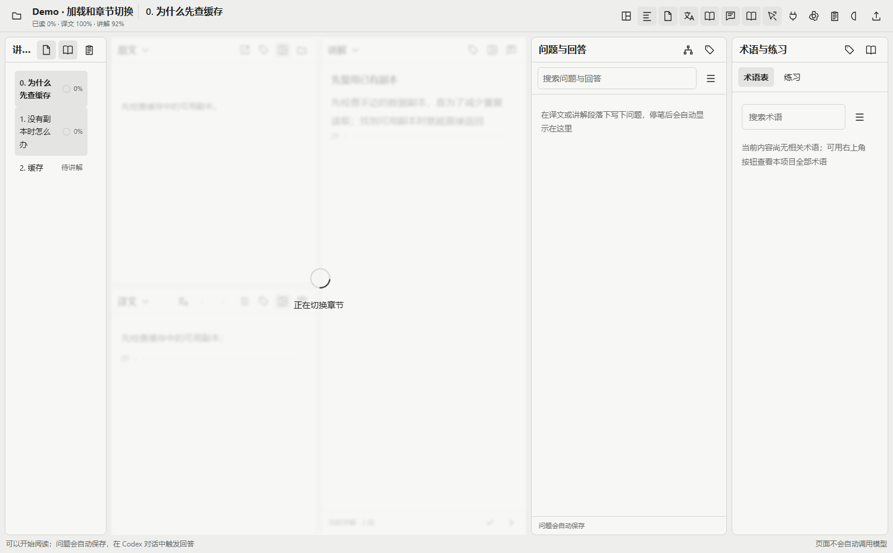

图 10.1 加载提示跟随实际请求

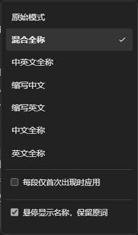

图 10.2 术语名称按栏目独立切换

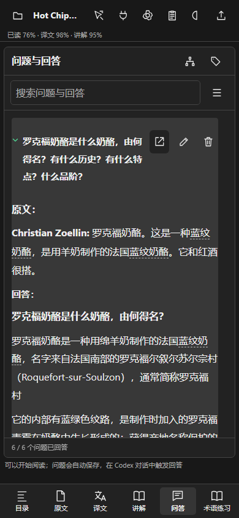

图 10.3 手机继续阅读同一份问答

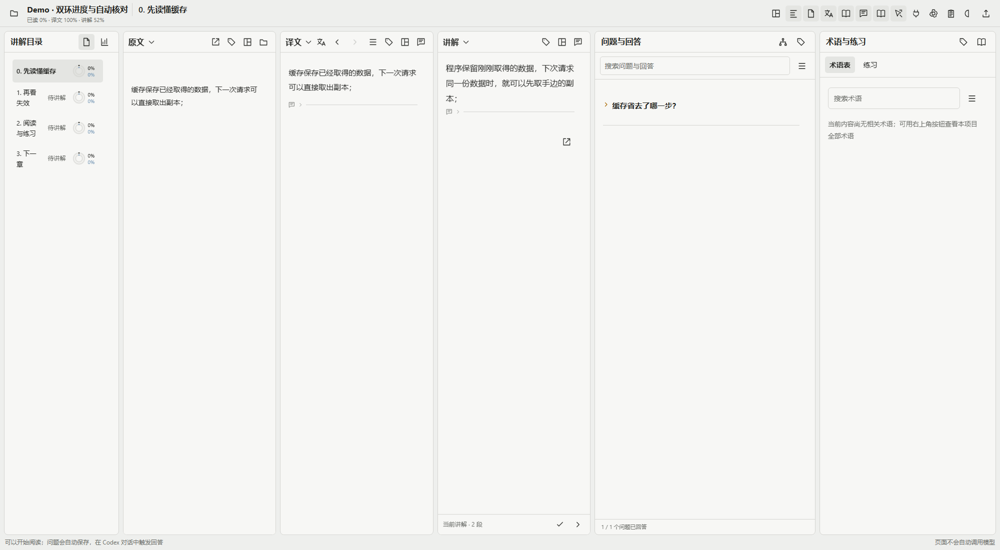

图 10.4 双环也适用于桌面目录

# 11 大项目实际使用时怎样配合

下面是官网持续阅读的 Hot Chips 访谈，包含真实原件、翻译、逐章讲解、用户追问、术语和练习；截图时所有写入请求被拦截，笔记和进度保持原状；文章内容来自公开访谈，作者署名保留

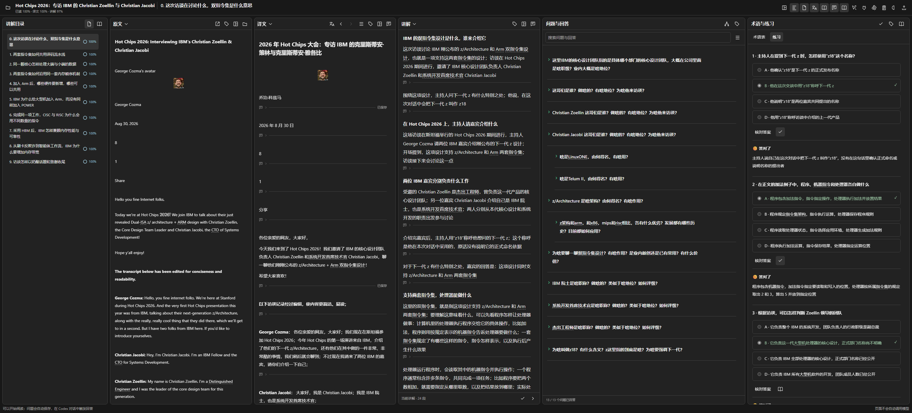

图 11 官网大项目实际页面；各区仍可独立调整或在手机切换

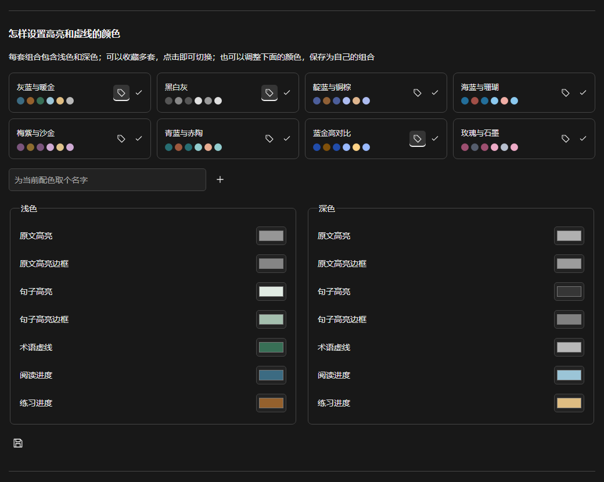

图 11.1 每套同时保存浅色与深色；收藏、默认与当前使用状态分别显示

# 10 项目文件怎样与阅读窗口共用位置

目录可分成上下两窗或三窗，分别保留学习路线、文件树和练习进度；从文件树打开的普通标签与主原文共用原文栏，点击阅读映射就返回主标签；完整接口和预览范围见[项目文件说明](project-files.md)

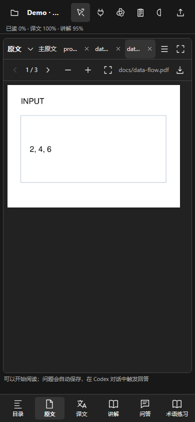

图 10 手机在原文栏查看项目文件；截图使用自撰合成内容，主阅读映射与章节记录继续保留

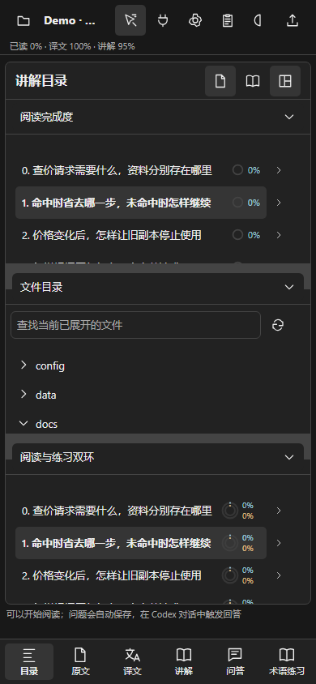

图 11 手机目录的三层拆分；每一层可以单独切换，也可以还原单窗

