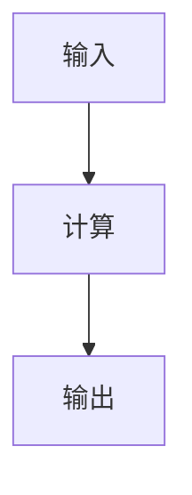

# 合成算例 · 第 2.3 节写作任务卡

## 项目与章节

| 字段 | 内容 |
|---|---|
| 项目 | 合成算例 |
| 项目编号 | sample-optimization |
| 项目目录 | /example/reader/sample-optimization |
| 章节 | 2.3 |
| 目录节点 | sample-convexity |
| 父节点 | sample-math |
| 正式标题 | 怎样用Hessian和特征值判断凸性 |

## 版本

| 字段 | 内容 |
|---|---|
| 材料结构版本 | 2 |
| 工作区修订 | 8 |
| 用户记录修订 | 4 |
| 目录选择修订 | 2 |
| 文件清单版本 | 1 |

## 当前状态与进度

文件覆盖进度：0.00%  
讲解完成进度：25.71%（9/35）  
总进度：12.86%

## 上一节内容

### 上一节标题

怎样认识一个合成二次函数

### 上一节承接

> 上一节从一个可计算的合成函数入手

> 这一节把两个方向的变化集中起来看

### 上一节回顾

#### 变量

例题定义两个试验数量  
试验数量可以取哪些值  
两个数量都取非负实数  
例题在连续范围内观察函数  
x=1 与 y=2 都在范围内  
先确认变量的范围  

#### 目标函数

例题比较两项试验的代价  
哪组数量代价最低  
代价等于两个数量的平方和  
两个贡献可以分别计算后相加  
x=1 与 y=2 时，代价为 5  
比较前先分别代入  

#### 一阶导数

试验数量可以小幅变化  
代价变化得多快  
每个方向有一个变化率  
观察一个方向时固定另一个变量  
x 方向的变化率是 2x  
在不同位置计算变化率  

#### 二阶导数

变化率本身也会变化  
曲率由什么量表示  
对变化率再求一次导数  
平方项求导两次会留下常数  
x 方向得到 2  
用二阶信息解释曲率  

#### 约束

例题限定数量总和  
哪些组合可以参与比较  
只比较满足上限的组合  
超过上限的组合超出了定义域  
上限为 2 时，x=3 不可行  
把可行性与代价值分开核对  

#### 候选点

例题给出两个可行点  
哪一点的代价更低  
将每组数分别代入目标函数  
两组都按同一尺度计算  
零点的代价为 0，而 (1,0) 的代价为 1  
只比较两个点还不足以证明全局最优  

### 上一节预测

> 接下来把二阶信息写成矩阵，用它判断函数的形状

## 上次的提问告诉我们，哪些地方值得讲细一点

| 提问风格 | 解释强化方向 |
|---|---|
| 这个式子有哪些组成项？ | 指出各项在当前问题中的作用 |
| 两个量为什么可以比较？ | 说明比较的单位和条件 |
| 能举一个小例子吗？ | 给出能手算的简单例子 |
| 这个结果在哪些条件下成立？ | 交代推导采用的条件 |

## 本章标题

怎样用Hessian和特征值判断凸性

## 本章宏观目标

### 读者想弄懂的知识点

- Hessian 是什么
- 二阶偏导在矩阵中表示什么
- 特征值的正、负、零
- 碗形、槽形和鞍形
- 凸性与最小值
- 二次规划中的变量、目标函数和约束

### 教师希望教授的知识点

- Hessian
- 偏导矩阵
- 纯二阶偏导
- 混合偏导
- \(f(x)=\frac12x^\mathsf{T}Qx+c^\mathsf{T}x+d\)
- 二次型与对称矩阵
- 特征值与特征向量
- 正定、半正定与不定
- 凸性判据
- 零曲率方向
- 线性约束与可行域
- 二次规划
- quadprog 与 eig

## 本节依据的材料

### synthetic-optimization.pdf

| 字段 | 内容 |
|---|---|
| 文件编号 | sample-optimization-file |
| 相对路径 | sources/synthetic-optimization.pdf |
| 状态 | 有效 |
| 加入轮次 | 1 |
| 本轮开始前的覆盖进度 | 0.00% |
| 内容简介 | 用于比较导数、曲率与约束的合成讲义 |

来源页码：第 9 页, 第 10 页, 第 11–14 页

来源编号：38 个已登记单元（完整 ID 列表见 JSON 中 `material_plan[].source_ids`）

## 写作偏好

### 主体与动作明确

需求定义：当执行者发生变化时，清楚交代谁完成了什么、结果交给谁。

Bad：

收齐订单后开始计算，算完发给商家

Good：

订单服务收齐订单后，会把这一批订单交给计费程序；计费程序按每笔订单的金额和费率算出手续费，再把账单发给商家

### 事实自然推动下一步

需求定义：当前事实应当解释后续动作为什么发生，避免机械宣布写作步骤。

Bad：

甲店一周卖了 100 件，乙店卖了 120 件，接下来算日均

Good：

甲店一周卖了 100 件，乙店卖了 120 件；可甲店只开了 4 天，乙店开了 6 天；营业天数不同，需要分别除以实际营业天数，才能比较两家店每天平均卖了多少

### 用实际过程建立理解

需求定义：关键过程需要明确对象、动作、触发条件与结果。

Bad：

先看柜门，想想为什么没有短信，再分析传感器

Good：

快递员把包裹放进柜子后关上柜门；传感器确认门已关闭，系统才发送取件码；所以包裹即使已经放进柜内，只要柜门还没关，收件人就可能尚未收到短信

### 避免无必要的防御性解释

需求定义：直接讲述材料已有的事实和判断，不反复反驳材料没有提出的观点。

Bad：

没有完整财务数据，因此不能证明所有初创公司都存在融资问题，也不能根据一次欠薪推断整个行业经营困难

Good：

嘉宾把公司欠薪归因于后续融资没有接上；第一次欠薪时他选择继续等待，第二次再次发生后决定离开

### 解释必要条件而不编造原因

需求定义：实际条件、推导结果与人物动机分别处理；没有证据时不为了补全因果链而自行编造。

Bad：

主角没有开门，是因为他早已知道整场阴谋，故意观察谁会背叛自己

Good：

主角听见门外有人敲门，却没有回应；随后门外的人离开，故事在这一段没有交代他保持沉默的原因

## 格式规范

### 中文标点

需求定义：新写中文正文遵循句号、分号和段末标点规范；代码、公式和原文引文不参与替换。

Bad：

先计算二阶偏导数。然后求 Hessian 的特征值。最后判断凸性。

Good：

先计算二阶偏导数；然后求 Hessian 的特征值；最后根据特征值判断凸性

### 中文冒号

需求定义：冒号只用于定义或引出并列内容，不作为普通语句之间的装饰性连接符。

Bad：

我们接下来：先看变量，再看结果

Good：

需要核对两个对象：

- 变量
- 结果

### 并列项与缩进

需求定义：同一层级至少两个事项才使用列表；每项只有一条补充说明时直接写在该项后面；只有某项内部至少两个独立子项时才使用嵌套列表。

Bad：

```markdown
需要检查两个部分：

- 目标函数
  - 核对二次项和一次项
- 约束条件
  - 核对变量上限
```

Good：

```markdown
需要检查两个部分：

- 目标函数：核对二次项和一次项
- 约束条件：核对变量上限
```

### 单一事项不使用并列格式

需求定义：只有一个事项时使用正常句子或段落，不创建单元素列表。

Bad：

```markdown
需要检查：

- 矩阵的维度
```

Good：

需要检查矩阵的维度

### 中英文与数字间距

需求定义：普通中文与英文、数字之间保留合理间距；代码、URL、数学表达和标准标识符不做机械替换。

Bad：

Hessian矩阵包含2阶偏导数，可用于判断函数是否Convex

Good：

Hessian 矩阵包含二阶偏导数，可用于判断函数是否具有凸性

### Markdown 标题

需求定义：使用统一层级，不重复显示 Reader 目录标题，不额外引入装饰性序号。

Bad：

```markdown
# 第 2.3 节 怎样用Hessian和特征值判断凸性

# 第一部分

## 1.1 特征值
```

Good：

```markdown
## Hessian 怎样描述曲率

## 特征值与凸性判断
```

### LaTeX 公式

需求定义：使用合法的 LaTeX 定界符，保持变量、上下标与数学含义。

Bad：

`H = d2f/dx12 d2f/dx1dx2 d2f/dx2dx1 d2f/dx22`

Good：

```latex
\[
H_f(x)=
\begin{pmatrix}
\frac{\partial^2 f}{\partial x_1^2} &
\frac{\partial^2 f}{\partial x_1\partial x_2}\\
\frac{\partial^2 f}{\partial x_2\partial x_1} &
\frac{\partial^2 f}{\partial x_2^2}
\end{pmatrix}
\]
```

### 代码与日志

需求定义：代码使用对应语言的 Markdown 围栏，原始日志使用 `console`，不得修改代码内容。

Bad：

`for i in range(3): print(i)` 被当作普通正文排版

Good：

```python
for i in range(3):
    print(i)
```

### 表格

需求定义：多行同类数据可以使用 Markdown 表格，必须有表头和分隔行。

Bad：

名称 数值；A 3；B 5

Good：

```markdown
| 名称 | 数值 |
|---|---:|
| A | 3 |
| B | 5 |
```

### 图片与媒体

需求定义：图片需要明确的引用、说明或图注；必要时保留原图位置，不将缺失图片伪装成已有资源。

Bad：

从下图可以看出三种曲面的区别

Good：

课件第 10 页展示了三种曲面：碗形、槽形和鞍形；图中的弯曲方向分别对应 Hessian 不同的特征值情况

### Mermaid 与图示方向

需求定义：流程图使用受支持的 Mermaid 结构；默认 `flowchart TD`；横向布局遵循 Reader 现有的显式标记规则。

Bad：

输入 -> 计算 -> 输出

Good：



### 原文与受保护内容

需求定义：格式处理不得修改逐字引文、源代码、公式、URL、真实文件路径和原始数据。

Bad：

为统一正文风格，把原始访谈引用中的句号全部替换为分号

Good：

正文标点遵守 Reader 规范；原始访谈引用保持来源中的文字和标点

## 用户特殊写作要求

无
